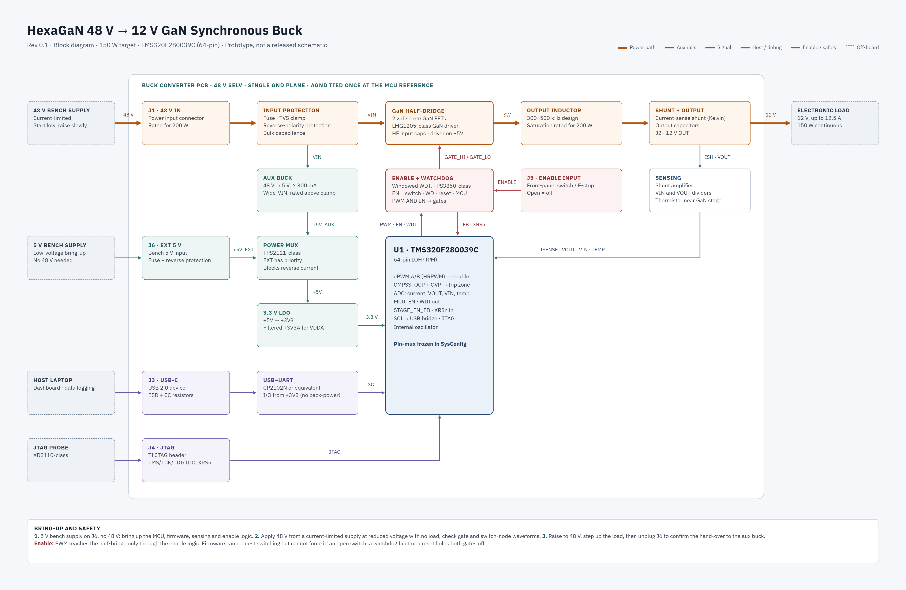

# HexaGaN 48 V → 12 V GaN Synchronous Buck

A GaN-based synchronous buck converter with an onboard C2000 microcontroller, digital control and layered protections. HexaGaN's first in-house power PCB, built as a learning platform for the team and a rehearsal for the universal control board's power-stage interface.

> **Status (November 2026): pre-layout schematic review.** Circuitry on all six subsheets is captured and the root sheet is wired. A fresh hierarchy ERC reports zero violations under the project's configured checks; the PCB still has no placed footprints or outline. The [PWM overlap decision](docs/design/enable.md#open-questions) and [+5V handover margin](docs/design/input_supply.md#values-published-to-other-sheets) remain open before layout freeze.



## At a glance

| | |
|---|---|
| Conversion | 48 V in → 12 V out, synchronous buck |
| Output | 12.5 A, 150 W design target; parts and copper rated for 200 W |
| Switching frequency | 400 kHz nominal, adjustable 300–500 kHz in firmware |
| Power stage | 2 × Infineon IGC033S10S1 GaN FETs, TI LM5113-Q1 gate driver |
| Controller | TI TMS320F280039C, 64-pin LQFP (same device as the universal control board) |
| Control | Staged bring-up: open loop → voltage mode → average current mode |
| Protections | Cycle-by-cycle overcurrent (CMPSS), output overvoltage, input undervoltage lockout, overtemperature, hardware enable, and static both-high PWM inhibit. Dynamic overlap protection is under review before layout freeze |
| Host interface | USB-C serial (CP2102N USB-UART bridge, ESD-protected) and a TI-compatible JTAG header |
| Assembly | JLCPCB Economic PCBA, single-sided |

Targets are in [docs/specifications.md](docs/specifications.md); each sheet's decisions and parts are in its design note in [docs/design/](docs/design/).

## Schematic sheets and owners

| # | Sheet | Owner | Status |
|---|---|---|---|
| 1 | Top (root sheet) | Reza Rahimzadeh | Wired: all six sheet symbols connected by their hierarchical pins. Four isolated NPTH M3 mounting holes (H101–H104), a main-specifications block and a power tree added. Bring-up safety notes still to add |
| 2 | input_supply | Reza Rahimzadeh | Schematic complete: 48 V protection, input shunt, aux regulator, 5 V mux and 3.3 V LDO. Wired on the root sheet |
| 3 | power_stage | Reza Rahimzadeh | Captured; wired on the root sheet |
| 4 | sensing | Connor Jin | Circuitry captured (six channels); labels aligned with the MCU sheet; wired on the root sheet |
| 5 | mcu | Yunxi He | Captured, with 16 MHz external crystal; all interface labels wired on the root sheet |
| 6 | enable | Connor Jin | Captured: watchdog, enable switch, `STAGE_EN` gating and static both-high inhibit. Dynamic overlap protection remains under review. Wired on the root sheet |
| 7 | comms_debug | Yunxi He | Captured: USB-C with CP2102N bridge and USBLC6 ESD protection, JTAG header. Wired on the root sheet |

The table uses each sheet's file name. On the root sheet the symbols carry display names (Input Supply, Power Stage, Sensing, Microcontroller, Enable, Comms and Debug).

Only a sheet's owner edits it. What each sheet contains and every signal that crosses between sheets are defined in [docs/schematic-hierarchy.md](docs/schematic-hierarchy.md).

## Repository layout

```
CONTRIBUTING.md              How we work: workflow, conventions, libraries, merge checklist
docs/
  specifications.md          Targets, limits and headline parts
  schematic-hierarchy.md     The contract between sheets: contents, signals, connectors
  design/                    One design note per sheet: decisions, calculations, parts, layout, tests
  guides/
    preferred-parts.md       JLCPCB passives to pick first, with measured DC-bias derating
    jlcpcb-assembly.md       Fab and assembly rules, ordering workflow, pre-order checklist
  firmware/
    firmware-requirements.md         Plain-language firmware guide for the firmware team
    edge-ai-dead-time-optimizer.md   Proposal: on-board model that picks the lowest-loss dead time and frequency
    pinmux-hardware.md              Physical MCU pin allocation frozen for PCB routing
  datasheets/                Datasheets and reference images for key parts (MCU, crystal, JTAG pinout)
  gan-buck-converter-BOM.xlsx  Cost and notes per sheet, refreshed from KiCad BOM exports
hardware/gan-buck-converter/
  gan-buck-converter.kicad_pro / .kicad_sch / .kicad_pcb   KiCad 10 project (root sheet and board)
  sheets/                    The six hierarchical sheets
  lib/                       hexagan library: hand-made symbols, footprints, 3D models
  JLCImport.*                Parts imported from LCSC by the JLCImport plugin
simulations/
  voltage_mode_sim.py        Python model of the voltage-mode control loop: Bode plots, load step
  input_hotplug_sim.py       Input hot-plug ringing and damping, bulk-capacitor ripple, input-filter stability
  README.md                  How to run it, how to read the plots, what we've learned
```

Firmware source (C2000, SysConfig) will live in `firmware/` once that work starts.

## Contributing

Read [CONTRIBUTING.md](CONTRIBUTING.md) before your first commit: tool setup, the pull-and-push routine, schematic conventions, library rules and the checklist every sheet passes before it merges.

## Safety

48 V is below the 60 V DC SELV limit, but a shorted output or a failed switch can still deliver large currents and burn hardware.

- Always bring up from a **current-limited bench supply**, starting at reduced input voltage with no load.
- Connect J201 with the 48 V supply output **off**, then enable the supply. Do not routinely live-plug at 51 V until the revised input protection is measured; the controlled hot-plug test is in [input_supply.md](docs/design/input_supply.md#verification).
- Bring up the 5 V supply (through J202, the keyed external 5 V input, set to 5.0 V) before applying 48 V. J202 cuts off above about 5.2–5.7 V.
- Check polarity before connecting any electronic load or source. J201 (48 V in) and J301 (12 V out) are identical screw terminals: 48 V on J301 destroys the output capacitors.
- Use a 48 V supply whose **DC output floats from earth**; keep the supply's chassis protective earth connected. Set supply OVP near 55 V if available. Above about 57 V the input TVS conducts continuously.
- **Q201 grounding rule:** J201− is separate from board `GND`. Attach grounded scope clips only to board `GND`, never J201−. If both supply negative and board `GND` are earthed, USB/JTAG/scope wiring can carry input return current around Q201 during normal operation. Swapping the input leads alone does not create that bypass, but a fixed J201−-to-GND short defeats the reverse block. Keep H101–H104 isolated and their copper clear.
- **Grounded-scope design limit:** Moving reverse protection to the positive rail alone does not eliminate the supply/scope earth loop. If J201− were then tied directly to board `GND`, reversed leads with a grounded scope attached could short supply positive to earth outside F201. Use the [grounding and scope note](docs/design/input_supply.md#grounding-and-scope-measurements) before changing this topology or using a shared-ground source.
- The power stage stays disabled until the hardware enable is asserted. Firmware alone cannot enable it.
Normal return path:
board GND ── Q201 ── J201− ── supply negative
If there is a grounded scope attached: board GND ── scope/USB ground ── earth ── supply negative
