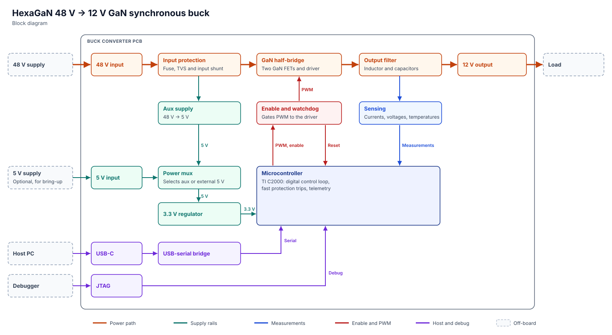

# HexaGaN 48 V → 12 V GaN Synchronous Buck

A GaN-based synchronous buck converter with an onboard C2000 microcontroller, digital control and layered protections. HexaGaN's first in-house power PCB, built as a learning platform for the team and a rehearsal for the universal control board's power-stage interface.



> **PCB layout in progress (2026-11-27).** The XT30 input return now connects directly to board `GND`. The 48 V input relies on correct harness polarity. The 120 × 80 mm board has a centered 107 × 67 mm mounting pattern and front-silkscreen test-point labels. [Input circuit](docs/design/input_supply.md) · [Connector layout](docs/design/input-output-connectors.md)
>
> With zones refilled, KiCad reports **one +3.3 V open, zero clearance violations under the current rules, zero schematic-to-PCB parity issues and 398 silkscreen warnings**. ERC reports zero errors and 11 warnings, including the old `V_IN_RTN` label sharing `GND`. The published KiPI efficiency and ringing results use the earlier board with Q201. [KiPI results](simulations/README.md#routed-board-kipi-and-ngspice-2026-11-27) · [PCB stackup](docs/design/stackup.md)

## At a glance

| | |
|---|---|
| Conversion | 48 V in → 12 V out, synchronous buck |
| Output | 12.5 A, 150 W design target; parts and copper rated for 200 W |
| Switching frequency | 400 kHz nominal, adjustable 300–500 kHz in firmware |
| Power stage | 2 × Infineon IGC033S10S1 GaN FETs, TI LM5113-Q1 gate driver |
| Controller | TI TMS320F280039C, 64-pin LQFP (same device as the universal control board) |
| Control | Staged bring-up: open loop → voltage mode → average current mode |
| Protections | Cycle-by-cycle overcurrent (CMPSS), output overvoltage, input undervoltage lockout, overtemperature, hardware enable, and static both-high PWM inhibit. Dynamic overlap protection is under review before layout freeze |
| Host interface | USB-C serial (CP2102N USB-UART bridge, ESD-protected) and a TI-compatible JTAG header |
| Assembly | Single-sided JLCPCB Economic PCBA. [Five-board estimate](docs/guides/jlcpcb-assembly.md#7-five-board-prototype-estimate) |

Targets are in [docs/specifications.md](docs/specifications.md); each sheet's decisions and parts are in its design note in [docs/design/](docs/design/).

## Schematic sheets and owners

| # | Sheet | Owner | Status |
|---|---|---|---|
| 1 | Top (root sheet) | Reza Rahimzadeh | Wired: all six sheet symbols connected by their hierarchical pins. Four plated M3 mounting holes (H101–H104), pads on no net, a main-specifications block and a power tree |
| 2 | input_supply | Reza Rahimzadeh | Fused 48 V input with a TVS and common return, input shunt, aux regulator, 5 V mux and 3.3 V LDO. Wired on the root sheet |
| 3 | power_stage | Reza Rahimzadeh | Captured, with reduced input and output capacitor banks (decision #24); wired on the root sheet |
| 4 | sensing | Connor Jin | Circuitry captured (six channels); labels aligned with the MCU sheet; wired on the root sheet |
| 5 | mcu | Yunxi He | Captured, with 16 MHz external crystal; all interface labels wired on the root sheet |
| 6 | enable | Connor Jin | Captured: watchdog, enable switch, `STAGE_EN` gating and static both-high inhibit. Dynamic overlap protection remains under review. Wired on the root sheet |
| 7 | comms_debug | Yunxi He | Captured: USB-C with CP2102N bridge and USBLC6 ESD protection, JTAG header. Wired on the root sheet |

The table uses each sheet's file name. On the root sheet the symbols carry display names (Input Supply, Power Stage, Sensing, Microcontroller, Enable, Comms and Debug).

Only a sheet's owner edits it. What each sheet contains and every signal that crosses between sheets are defined in [docs/schematic-hierarchy.md](docs/schematic-hierarchy.md).

## Repository layout

```
CONTRIBUTING.md              How we work: workflow, conventions, libraries, merge checklist
docs/
  specifications.md          Targets, limits and headline parts
  schematic-hierarchy.md     The contract between sheets: contents, signals, connectors
  design/                    One design note per sheet: decisions, calculations, parts, layout, tests
  guides/
    preferred-parts.md       JLCPCB passives to pick first, with measured DC-bias derating
    jlcpcb-assembly.md       Fab and assembly rules, ordering workflow, pre-order checklist
  firmware/
    firmware-requirements.md         Plain-language firmware guide for the firmware team
    edge-ai-dead-time-optimizer.md   Proposal: on-board model that picks the lowest-loss dead time and frequency
    pinmux-hardware.md              Physical MCU pin allocation frozen for PCB routing
  datasheets/                Datasheets, application notes and reference images the design notes link to
  block-diagram.svg          Board block diagram (edit the SVG directly when the architecture changes)
  gan-buck-converter-BOM.xlsx  Cost and notes per sheet, one row per unique part, rebuilt from the schematic
hardware/gan-buck-converter/
  gan-buck-converter.kicad_pro / .kicad_sch / .kicad_pcb   KiCad 10 project (root sheet and board)
  sheets/                    The six hierarchical sheets
  lib/                       hexagan library: hand-made symbols, footprints, 3D models (see lib/README.md)
  JLCImport.*                Parts imported from LCSC by the JLCImport plugin
simulations/
  voltage_mode_sim.py        Python model of the voltage-mode control loop: Bode plots, load step
  input_hotplug_sim.py       Input hot-plug ringing and damping, bulk-capacitor ripple, input-filter stability
  efficiency_estimate.py     Component loss budget and theoretical efficiency vs load, input voltage and frequency
  README.md                  How to run it, how to read the plots, what we've learned
```

Firmware source (C2000, SysConfig) will live in `firmware/` once that work starts.

## Contributing

Read [CONTRIBUTING.md](CONTRIBUTING.md) before your first commit: tool setup, the pull-and-push routine, schematic conventions, library rules and the checklist every sheet passes before it merges.

## Safety

48 V is below the 60 V DC SELV limit, but a shorted output or a failed switch can still deliver large currents and burn hardware.

- Always bring up from a **current-limited bench supply**, starting at reduced input voltage with no load.
- Connect J201 with the 48 V supply output **off**, then enable the supply. Do not routinely live-plug at 51 V until the revised input protection is measured; the controlled hot-plug test is in [input_supply.md](docs/design/input_supply.md#verification).
- Bring up the 5 V supply (through J202, the keyed external 5 V input, set to 5.0 V) before applying 48 V. J202 cuts off above about 5.2–5.7 V.
- Check polarity before connecting any electronic load or source. J201 is a male XT30 48 V input and J301 is a female XT60 12 V output; they require separate soldered adapter cables. 48 V on J301 destroys the output capacitors. See the [connector and harness instructions](docs/design/input-output-connectors.md).
- Use a 48 V supply whose **DC output floats from earth**; keep the supply's chassis protective earth connected. Set supply OVP near 55 V if available. Above about 57 V the input TVS conducts continuously.
- Attach ordinary grounded probe clips at a board `GND` test point. The XT30 negative pin shares `GND`. With an earth-bonded supply and reversed input leads, a grounded scope, USB or JTAG connection can short the supply outside F201. [Grounding and scope measurements](docs/design/input_supply.md#grounding-and-scope-measurements)
- Keep the plated H101–H104 rings electrically floating and check copper clearance around the mounting hardware. [Mechanical specifications](docs/specifications.md#mechanical-and-other)
- The power stage stays disabled until the hardware enable is asserted. Firmware alone cannot enable it.
