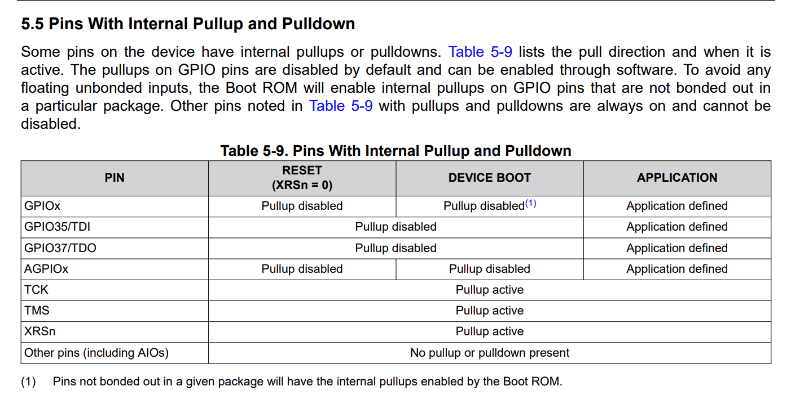
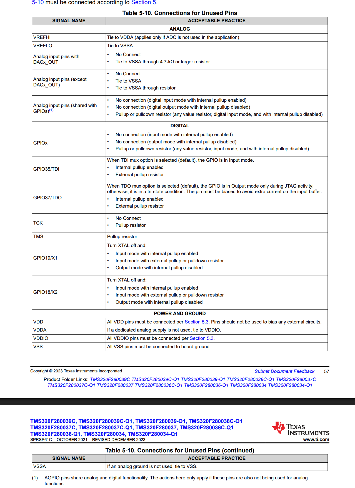

# MCU — Design Notes

Sheet: `sheets/mcu.kicad_sch`

**Owner:** Yunxi He · **Reviewer:** [NAME] · **Last updated:** 2026-11-05

## MCU section

Based on the MCU section of [schematic-hierarchy.md](../schematic-hierarchy.md), using the names currently present in the schematic. MCU connections were checked on 2026-11-04 and preserved while merging main on 2026-11-05; intended connections and unfinished interfaces are identified below.

## 5 · MCU — `mcu.kicad_sch`

**Responsible for:** the TMS320F280039C (U1, 64-pin LQFP) and everything it needs to run.

**Contains**
- U1 TMS320F280039C, 64-pin PM package
- Decoupling per TI's datasheet
- Internal core-regulator strapping and core-supply capacitance
- ADC reference and analog-supply capacitance
- **The single net tie joining `GNDA` to `GND`**, at the ADC reference
- Reset (`XRSn`, U1 pin 3) pull-up and capacitor
- External 20 MHz crystal **ECS-200-8-30B-CKM**, two **12 pF** load capacitors and an X2 series resistor; populated
- Boot-mode jumpers on the boot pins
- HEARTBEAT and FAULT LEDs

**Hierarchical labels**

| Signal | Dir | To / from |
|---|---|---|
| `MCU_PWMH`, `MCU_PWML` | out | enable |
| `MCU_EN` | out | enable |
| `WD_IN` | out | enable |
| `STAGE_EN_FB` | in | enable |
| `XRSn` | bidir | enable, comms_debug |
| `I_SENSE`, `VOUT_SENSE`, `VIN_SENSE`, `TEMP_SENSE` | in | sensing |
| `SCI_TX` | out | comms_debug |
| `SCI_RX` | in | comms_debug |
| `TCK`, `TMS`, `TDI` | in | comms_debug |
| `TDO` | out | comms_debug |

**Notes**
- Every U1 pin assignment must match `pinmux.syscfg`. Change the `.syscfg` first, then the schematic.
- `MCU_PWMH` / `MCU_PWML` are one ePWM A/B pair on high-resolution-capable pins, with dead time generated in the ePWM.
- `I_SENSE` and `VOUT_SENSE` go on ADC pins that also reach CMPSS comparators, routed through the ePWM X-BAR to the trip zone, so overcurrent and overvoltage shut the PWM down in hardware.
- Keep the boot pins free of any function that could be driven during boot.

---

## Purpose and requirements

U1 controls the 48 V-to-12 V buck converter using the TMS320F280039C, 64-pin PM package.

- Generate a high-resolution PWM pair with dead time; measure current, input/output voltage and temperature. Use hardware comparator trips for overcurrent and overvoltage.
- Support open loop, voltage mode and average current mode; provide enable/watchdog control, serial communication, JTAG and status LEDs. Start with switching off and boot from flash.
- Provide power, decoupling, reference, reset and boot circuits. Match the final SysConfig pin assignment and the project's single `GNDA`-to-`GND` net tie.

**Draft:** signal assignments and example component values below are proposed; `firmware/pinmux.syscfg` and protection thresholds are not finalized. Requirements are retained here with the current schematic names. See [specifications](../specifications.md) for converter targets.

Input-current telemetry (`I_IN_SENSE`) is also required for input power and the input-current limit. Its MCU ADC pin and top-sheet connection remain unassigned; retain the existing unused-pin markers until that assignment is chosen.

---

Check page 57 for connections for Unused Pins

Pins with internal pullup and pulldown:

Connections for Unused Pins

- **Schematic treatment:** No-connect markers are placed on unused physical pins 7, 8, 10-15, 19, 20, 24, 25, 29-34, 47, 54-57 and 61-64 (27 pins total). These markers document intentionally open pins; they do not enable internal pull-ups.
- **Firmware still required:** Configure unused GPIO5-13, GPIO16, GPIO17, GPIO22, GPIO23, GPIO33 and GPIO41 as GPIO inputs with internal pull-ups enabled. Keep unused analog/DAC functions disabled. No firmware configuration was changed when placing the markers.

---

## Concrete connections for the selected MCU

Device: **F280039CSPMR**, LCSC **C20345419**, standard 64-pin PM LQFP. The `R` is reel packaging; the pinout matches F280039CSPM. Pin numbers below are physical package pin numbers.

### Captured-circuit ERC status - 2026-11-05

- Project-library and embedded symbol electrical types have been corrected. Resistors, capacitors, LEDs and U2 use Passive terminals. U1 uses the selected power/input/bidirectional classifications; its internal VDD outputs are modeled as Power output. No component references, signal names, part choices or component-to-component connections were changed.
- All 27 unused pins retain their no-connect markers. Firmware configuration of unused GPIO pull-ups is still required.
- All 16 MCU hierarchical labels now have matching parent-sheet pins. Six outgoing labels have Output direction; `XRSn` is Bidirectional; incoming labels are Input.
- The top sheet contains open MCU wire stubs and an explicit unfinished-interface note. Input-supply, power-stage and sensing circuits from main are retained; enable and comms_debug remain empty. No dummy source components or ERC exclusions were added.
- MCU interfaces retain **5 undriven-input errors** (`TCK`, `I_SENSE`, `VOUT_SENSE`, `VIN_SENSE`, `TEMP_SENSE`) and **25 unfinished-interface warnings** (16 open wire ends, 9 labels connected to one component pin). Top-sheet wiring and the debug source circuit remain unfinished. Full-project ERC after merging is **38 errors and 162 warnings**, compared with **33 errors and 137 warnings** on main before this merge. The difference is the five known MCU undriven inputs and 25 unfinished-interface warnings.
- MCU power flags on GND and GNDA are ERC declarations. The redundant MCU +3V3 flag and its standalone power symbol were removed during the merge because the power-stage sheet already declares +3V3 supplied. The +3V3 regulator and full supply integration still require completion.

To reload saved file edits in the open KiCad Schematic Editor, use **File -> Revert**. This reloads from disk and discards unsaved editor changes; a redraw or Update Symbols from Library does not reload the entire schematic.

### Pin functions and connections

Supply limits: [TI datasheet, Section 6.12.1.5.1, p. 80](../datasheets/tms320f280039c.pdf#page=80). Power-decoupling capacitor tolerance must be no greater than **20%**; check effective capacitance at operating voltage and temperature. Component values marked proposed still need exact MPNs.

#### `VDDIO`

- **Description:** 3.3 V supply for digital I/O and the internal core regulator.
- **Pins:** 28, 43, 60
- **Connection:** `+3V3`; local decoupling to `GND` at every pin.
- **Decoupling:** Minimum **0.1 µF (100 nF) per pin**; proposed **220 nF at each pin**. Additional regulator output/bulk capacitance depends on the regulator.
- **SR up:** **8-100 mV/µs**.
- **SR down:** **20-100 mV/µs**, falling-rate magnitude.
- **Brownout guardband:** **0.1 V typical** margin above the applicable brownout-reset threshold.
- **Supply arrangement:** The current schematic connects VDDIO and VDDA directly to `+3V3`. No separate filtered analog rail is drawn; a common source is permitted by TI.
- **Sequence:** Power the supply rails first; external signal pins should only be driven after `XRSn` goes high.
- **Chosen parts:** `Cvddio1`, `Cvddio2`, `Cvddio3` - 220nF; **CL10B224KA8NNNC**; **LCSC C21120**.
- **Saved capacitor connections:** Each of Cvddio1/Cvddio2/Cvddio3 has pin 2 on +3V3 and pin 1 on GND. The rail joins U1.28, U1.43 and U1.60; the netlist does not establish which capacitor will be placed closest to which supply pin.

#### `VDDA`

- **Description:** 3.3 V supply for analog circuitry.
- **Pins:** 22
- **Connection:** `+3V3` in the current schematic; plan a local capacitor return to the VSSA-side `GNDA`.
- **Decoupling:** Minimum **2.2 µF per pin**; proposed **4.7 µF** to `GNDA`.
- **Sequence:** Rise with or after VDDIO; enable analog modules only after VDDA reaches its operating voltage. No separate VDDA SR is specified in this table.
- **Chosen part:** `Cvdda5` - 4.7uF; **CL10B475KQ8NQNC**; **LCSC C107368**.
- **Saved capacitor connection:** `Cvdda5.1 -> +3V3/U1.22`, `Cvdda5.2 -> GNDA`. VSSA is also on `GNDA`; this analog return is now on the intended side of NT1. The common +3V3 supply is retained.

#### `VDD`

- **Description:** Internally generated 1.2 V supply for processor logic.
- **Pins:** 4, 27, 44, 59
- **Connection:** Decouple to `GND`; never connect to 3.3 V or use to power other circuitry.
- **Decoupling:** **10-26.8 µF total across all VDD pins**, not per pin. Proposed **4.7 µF per pin = 18.8 µF nominal total**; verify effective capacitance.
- 0603 capacitors
- **SR:** This package uses the internal regulator. The table's external-VREG SR and ramp-delay rows do not apply; external VREG mode is unsupported.
- **Chosen parts:** `Cvdd1`, `Cvdd2`, `Cvdd3`, `Cvdd4` - 4.7uF; **CL10B475KQ8NQNC**; **LCSC C107368**.
- **Saved capacitor connections:** `U1.4 -> Cvdd1.1`, `U1.27 -> Cvdd2.1`, `U1.44 -> Cvdd3.1`, `U1.59 -> Cvdd4.1`; pin 2 of each capacitor -> GND.

#### `VSS`

- **Description:** Digital ground return.
- **Pins:** 5, 26, 45, 58
- **Connection:** `GND`

#### `VSSA`

- **Description:** Analog ground return.
- **Pins:** 21
- **Connection:** `GNDA`; join to `GND` through the project's single net tie
- **Chosen implementation:** NT1, `Device:NetTie_2`; saved connection is `NT1.1 -> GND`, `NT1.2 -> GNDA`. The required copper-join assignment is now present; this is the single intended join between these two named grounds.

#### `VREFHI` / `VREFLO`

- **Description:** ADC high and low voltage references.
- **Pins:** 16 / 17
- **Connection:** Reference capacitor between these pins; `VREFLO` to `GNDA`
- **Capacitor:** **2.2 µF ceramic** between pins 16 and 17, close to the MCU.
- **Proposed mode:** Internal reference, **0-3.3 V conversion range**; VREFHI is driven internally at approximately **1.65 V**. Do not tie it to 3.3 V or drive it externally.
- **Chosen part:** `C1` - 2.2uF; **GRM188R71A225KE15D**; **LCSC C86018**.
- **Saved capacitor connection:** `C1.2 -> U1.16/VREFHI`, `C1.1 -> U1.17/VREFLO -> GNDA`; `U1.21/VSSA` is also on `GNDA`. This return connection is now correct.

#### `XRSn` - physical pin 3

- **Description:** Active-low reset; the MCU can also pull this pin low.
- **Pins:** 3
- **Connection:** Pull up to `+3V3`; share with open-drain supervisor/debugger reset outputs
- **Pull-up:** TI range **2.2-10 kΩ**, used 4.7k.
- **Filter capacitor:** Proposed **10 nF to GND**; TI maximum **100 nF**. Check supervisor/debugger reset behavior, used 22 nF for now
- **Chosen part:** `R1` - 4.7k; **RCT034K7JLF**; **LCSC C177333**.
- **Saved connection:** `R1.2 -> +3V3`, `R1.1 -> U1.3/XRSn`; `C2.1 -> U1.3/XRSn`, `C2.2 -> GND`. R1 now pulls up the correct reset pin. The bidirectional `XRSn` hierarchical label and its matching parent-sheet pin are present; supervisor/debugger reset circuitry remains unfinished.
- **Chosen part:** `C2` - 22nF; **CL10B223KB8NNNC**; **LCSC C21122**.
- **Saved filter connection:** `C2.1 -> U1.3/XRSn`, `C2.2 -> GND`; the capacitor branches from reset to ground, while R1 pulls reset up to +3V3.

#### `TCK` / `TMS`

##### TCK - physical pin 36

- **Function:** JTAG clock input from the debugger; hierarchical label `TCK`, input on the MCU sheet, from `comms_debug`.
- **Connection:** `U1.36 -> TCK` -> top-sheet connection -> debug header TCK. Header terminal number is not assigned yet.
- **Saved connection:** `U1.36 -> TCK`; R12 is no longer connected to this pin. The TCK hierarchical label is input, as required. The matching parent-sheet pin and open wire stub are present; the debug-header circuit and destination connection remain unfinished.

##### TMS - physical pin 38

- **Function:** JTAG mode-select input from the debugger; hierarchical label `TMS`, input on the MCU sheet, from `comms_debug`.
- **Intended connection:** `U1.38 -> TMS` -> top-sheet connection -> debug header TMS. Branch from the TMS signal through a **2.2 kOhm pull-up to +3V3**; TI recommended.
- **Chosen part for this pin:** `R12`, **2.2 kOhm**, +/-1%, 0603, 100 mW; **0603WAF2201T5E**, **LCSC C4190**. Intended endpoints: `R12.1 -> U1.38/TMS`, `R12.2 -> +3V3`.
- **Saved connection:** `R12.1 -> U1.38/TMS`, `R12.2 -> +3V3`; the TMS pull-up is now on the correct pin. The TMS hierarchical label is input. The matching parent-sheet pin and open wire stub are present; the debug-header circuit and destination connection remain unfinished.

#### `TDI` / `TDO`

##### GPIO35 / TDI - physical pin 39

- **Function:** Test Data In, debugger -> MCU; reserve GPIO35 for JTAG. Use an input hierarchical label `TDI` from `comms_debug`.
- **Connection:** `U1.39 -> TDI` -> top-sheet connection -> debug header TDI. Header terminal number remains unassigned.
- **Chosen part for this pin:** `R2`, **10 kOhm**, **RCT0310KJLF**, **LCSC C177337**; pull-up, with `R2.1 -> U1.39/TDI` and `R2.2 -> +3V3`.
- **Saved connection:** TDI label and R2 pull-up are present. Keep defined idle bias; verify against the chosen debugger/header.

##### GPIO37 / TDO - physical pin 37

- **Function:** Test Data Out, MCU -> debugger; reserve GPIO37 for JTAG. Use an output hierarchical label `TDO` to `comms_debug`.
- **Connection:** `U1.37 -> TDO` -> top-sheet connection -> debug header TDO. Header terminal number remains unassigned.
- **Chosen part for this pin:** `R3`, **10 kOhm**, **RCT0310KJLF**, **LCSC C177337**; pull-up, with `R3.1 -> U1.37/TDO` and `R3.2 -> +3V3`.
- **Saved connection:** TDO label and R3 pull-up are present; the hierarchical label is now output from the MCU sheet. Its matching parent-sheet pin and open connection stub are present. Keep defined idle bias because TDO releases the line when JTAG is inactive; the selected debugger/header circuit remains unfinished.

#### Boot select `GPIO24` / `GPIO32`

Both pins default high for the planned flash boot, assuming OTP boot settings are unchanged. Reserve them from functions driven during boot. The pull-ups are selected as 10 kOhm for now; boot jumper/header parts have not been chosen.

##### GPIO24 - physical pin 35

- **Function:** Boot-mode select, used together with GPIO32.
- **Connection:** `U1.35 -> R5.1`, `R5.2 -> +3V3`. Planned boot jumper connects the U1.35 signal to GND when fitted; jumper reference and terminal numbers remain TBD.
- **Chosen part for this pin:** `R5`, **10 kOhm**, **RCT0310KJLF**, **LCSC C177337**.
- **Saved connection:** R5 pull-up is present; boot jumper is absent.

##### GPIO32 - physical pin 40

- **Function:** Boot-mode select, used together with GPIO24.
- **Connection:** `U1.40 -> R6.1`, `R6.2 -> +3V3`. Planned boot jumper connects the U1.40 signal to GND when fitted; jumper reference and terminal numbers remain TBD.
- **Chosen part for this pin:** `R6`, **10 kOhm**, **RCT0310KJLF**, **LCSC C177337**.
- **Saved connection:** R6 pull-up is present; boot jumper is absent.

#### `GPIO18/X2` / `GPIO19/X1`

- **Shared selected crystal:** `U2`, **ECS-200-8-30B-CKM**, **LCSC C5727236**; 20 MHz, CL 8 pF, ESR <=40 Ohm, maximum drive 100 uW. Ground pads `U2.2` and `U2.4` connect to GND.
- **Population/configuration:** Populate the crystal, both load capacitors and the X2 series resistor; configure firmware for the 20 MHz external crystal. Keep connections short.
- **Load-capacitor specification:** 12 pF each, C0G/NP0, 0603, +/-5%, >=25 V. Check the effective load including PCB stray capacitance.
- **Original unresolved note:** X2 series resistance was written as "??? Ohm"; the current selected part is 0 Ohm, provisional pending drive/startup verification. The earlier "20hz" note refers to the selected 20 MHz crystal.

##### GPIO18 / X2 - physical pin 41

- **Function:** Crystal oscillator output; reserve GPIO18 for the external crystal.
- **Connection:** `U1.41/X2 -> R4.2`; `R4.1 -> U2.3` and `C4.2`; `C4.1 -> GND`. The resistor is in series with the crystal branch, and C4 is on the crystal side of it.
- **Chosen parts for this pin:** `R4`, **0 Ohm**, **0603WAJ0000T5E**, **LCSC C15402**; `C4`, **12 pF**, **CC0603JRNPO9BN120**, **LCSC C107034**; shared crystal U2 as above.
- **Saved connection:** These endpoints are present. R4's final resistance still needs startup/drive validation.

##### GPIO19 / X1 - physical pin 42

- **Function:** Crystal oscillator input; reserve GPIO19 for the external crystal.
- **Connection:** `U1.42/X1 -> U2.1` and `C3.1`; `C3.2 -> GND`.
- **Chosen parts for this pin:** `C3`, **12 pF**, **CC0603JRNPO9BN120**, **LCSC C107034**; shared crystal U2 as above.
- **Saved connection:** These endpoints are present. Crystal startup and drive level remain to be verified.

#### ADC inputs (`Ax`, `Bx`, `Cx`)

- **Description:** Analog-to-digital channels; 12-bit results range from 0 to 4095. The selected reference mode gives a 0-3.3 V measurement range.
- **Pins:** 6-15, 18-20, 23-25; names such as `A0`, `B2` and `C6` identify internal ADC channels.
- **Connection:** Scaled 0-3 V sensing signals; see the proposed channel assignments below.
- **Input RC/clamps:** Owned by sensing; values **TBD**. Meet acquisition time, input protection limits and comparator-trip bandwidth.

#### `DACA_OUT` / `DACB_OUT`

- **Description:** Digital-to-analog voltage outputs.
- **Pins:** 15 / 14, shared with ADC inputs.
- **Connection:** Connect to an analog-output circuit if needed; follow Table 5-10 when unused.

#### `GPIOx`

Digital inputs/outputs with peripheral functions selected in firmware. Each used pin below lists its own purpose, associated parts and known endpoints. Destination-sheet connector pin numbers and unselected parts stay TBD. Unassigned GPIOs have no new assignments or parts implied here.

The 10 kOhm pull-downs were originally assigned to the enable sheet; they are currently placed on the MCU sheet. Resolve ownership before adding duplicates. Keep the status LEDs off during startup and verify their current and package polarity.

##### GPIO0 - physical pin 52 - `MCU_PWMH`

- **Function:** EPWM1_A output; high-side PWM in the high-resolution-capable A/B pair. Generate dead time in ePWM.
- **Connection:** `U1.52 -> MCU_PWMH` -> enable sheet MCU_PWMH input. `R7.1 -> U1.52/MCU_PWMH`, `R7.2 -> GND`. Hardware enable gates this signal before the driver.
- **Chosen parts for this pin:** `R7`, **10 kOhm pull-down**, **RCT0310KJLF**, **LCSC C177337**.
- **Saved connection / remaining work:** Pin assignment and pull-down are present. The matching parent-sheet pin and open wire stub are present; hardware gating and the destination connection remain unfinished. MCU hierarchical direction is output; final SysConfig/dead time are not frozen.

##### GPIO1 - physical pin 51 - `MCU_PWML`

- **Function:** EPWM1_B output; low-side PWM paired with EPWM1_A, with dead time generated in ePWM.
- **Connection:** `U1.51 -> MCU_PWML` -> enable sheet MCU_PWML input. `R8.1 -> U1.51/MCU_PWML`, `R8.2 -> GND`. Hardware enable gates this signal before the driver.
- **Chosen parts for this pin:** `R8`, **10 kOhm pull-down**, **RCT0310KJLF**, **LCSC C177337**.
- **Saved connection / remaining work:** Pin assignment and pull-down are present. The matching parent-sheet pin and open wire stub are present; hardware gating and the destination connection remain unfinished. MCU hierarchical direction is output; final SysConfig/dead time are not frozen.

##### GPIO2 - physical pin 50 - `MCU_EN`

- **Function:** GPIO output requesting switching; the request is only one condition of hardware enable.
- **Connection:** `U1.50 -> MCU_EN` -> enable sheet MCU_EN input. `R9.1 -> U1.50/MCU_EN`, `R9.2 -> GND`.
- **Chosen parts for this pin:** `R9`, **10 kOhm pull-down**, **RCT0310KJLF**, **LCSC C177337**.
- **Saved connection / remaining work:** Pin assignment and pull-down are present. The matching parent-sheet pin and open wire stub are present; enable logic and the destination connection remain unfinished. MCU hierarchical direction is output.

##### GPIO3 - physical pin 49 - `WD_IN`

- **Function:** GPIO output providing the external windowed-watchdog check-in signal.
- **Connection:** `U1.49 -> WD_IN` -> enable sheet WD_IN input. Watchdog device/input-pin number and timing remain TBD.
- **Chosen parts for this pin:** No local support part selected for this pin; the watchdog is owned by the enable sheet.
- **Saved connection / remaining work:** WD_IN label is present. The matching parent-sheet pin and open wire stub are present; watchdog circuitry is unfinished; MCU hierarchical direction is output. Both too-fast and too-slow check-ins must count as failures.

##### GPIO4 - physical pin 48 - `STAGE_EN_FB`

- **Function:** GPIO input reading the hardware-enable state.
- **Connection:** Enable sheet STAGE_EN_FB output -> `STAGE_EN_FB -> U1.48`. Exact source gate/device pin remains TBD.
- **Chosen parts for this pin:** No local support part selected for this pin.
- **Saved connection / remaining work:** STAGE_EN_FB input label is present. The matching parent-sheet pin and open wire stub are present; the enable circuit and destination connection remain unfinished.

##### GPIO28 - physical pin 2 - `SCI_RX`

- **Function:** SCIA_RX input receiving serial data from the USB-UART bridge.
- **Connection:** Bridge TX -> comms_debug SCI_RX output -> `SCI_RX -> U1.2`. Bridge MPN and physical TX-pin number remain TBD.
- **Chosen parts for this pin:** No local support part selected for this pin; UART bridge is on comms_debug.
- **Saved connection / remaining work:** SCI_RX is on the intended physical pin. The matching parent-sheet pin and open wire stub are present; the bridge circuit and destination connection remain unfinished.

##### GPIO29 - physical pin 1 - `SCI_TX`

- **Function:** SCIA_TX output transmitting serial data to the USB-UART bridge.
- **Connection:** `U1.1 -> SCI_TX` -> comms_debug SCI_TX input -> bridge RX. Bridge MPN and physical RX-pin number remain TBD.
- **Chosen parts for this pin:** No local support part selected for this pin; UART bridge is on comms_debug.
- **Saved connection / remaining work:** SCI_TX is on the intended physical pin. MCU hierarchical direction is output. The matching parent-sheet pin and open wire stub are present; the bridge circuit and destination connection remain unfinished.

##### GPIO39 - physical pin 46 - `HEARTBEAT`

- **Function:** GPIO output driving the local green heartbeat/status LED.
- **Connection:** `U1.46 -> R10.2`; `R10.1 -> LED1.2` (anode); `LED1.1` (cathode) `-> GND`. R10 is the series current-limiting resistor.
- **Chosen parts for this pin:** `R10`, **1 kOhm**, **0603WAF1001T5E**, **LCSC C21190**; `LED1`, green **KT-0603G**, **LCSC C12624**.
- **Saved connection / remaining work:** This series branch is present. Keep off during startup; firmware heartbeat behavior, LED current and final package polarity need verification.

##### GPIO40 - physical pin 53 - `FAULT`

- **Function:** GPIO output driving the local red fault LED.
- **Connection:** `U1.53 -> R11.2`; `R11.1 -> LED2.1` (anode); `LED2.2` (cathode) `-> GND`. R11 is the series current-limiting resistor.
- **Chosen parts for this pin:** `R11`, **1 kOhm**, **0603WAF1001T5E**, **LCSC C21190**; `LED2`, red **KT-0603R**, **LCSC C2286**.
- **Saved connection / remaining work:** This series branch is present. Keep off during startup; firmware fault behavior, LED current and final package polarity need verification.

### Proposed signal-to-pin assignment

| Net | Direction | Physical pin | MCU function | Destination / purpose |
|---|---|---|---|---|
| `MCU_PWMH` | out | 52 | GPIO0 / EPWM1_A | enable; high-side PWM |
| `MCU_PWML` | out | 51 | GPIO1 / EPWM1_B | enable; low-side PWM, paired dead time |
| `I_SENSE` | in | 9 | A2/B6/C9; select ADCA channel 2 and CMPSS1 high positive input 0 (`CMP1_HP0`) | sensing; current feedback and cycle-by-cycle trip |
| `VOUT_SENSE` | in | 23 | A4/B8/C14; select ADCB channel 8 and CMPSS2 high positive input 0 (`CMP2_HP0`) | sensing; output feedback and latched overvoltage trip |
| `VIN_SENSE` | in | 6 | A6; ADCA channel 6 | sensing; input voltage |
| `TEMP_SENSE` | in | 18 | A12/C1; ADCC channel 1 | sensing; temperature |
| `MCU_EN` | out | 50 | GPIO2 | enable; request switching |
| `WD_IN` | out | 49 | GPIO3 | enable; external watchdog check-in |
| `STAGE_EN_FB` | in | 48 | GPIO4 | enable; hardware enable feedback |
| `SCI_TX` | out | 1 | GPIO29 / SCIA_TX | comms_debug; MCU TX to bridge RX |
| `SCI_RX` | in | 2 | GPIO28 / SCIA_RX | comms_debug; MCU RX from bridge TX |
| HEARTBEAT LED | out | 46 | GPIO39 | local status LED (green)|
| FAULT LED | out | 53 | GPIO40 | local fault LED (red)|

Reserve the fixed debug/boot pins above. Use hierarchical labels for signals between sheets; LEDs stay local. Route the two CMPSS trip outputs through the ePWM X-BAR into the ePWM digital-compare/trip-zone logic: current limiting is cycle-by-cycle; overvoltage is latched. The comparator mux selections, trip polarity and PWM-off actions still need implementation and validation.
