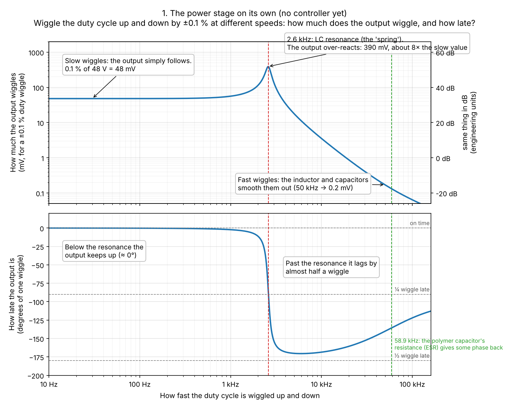
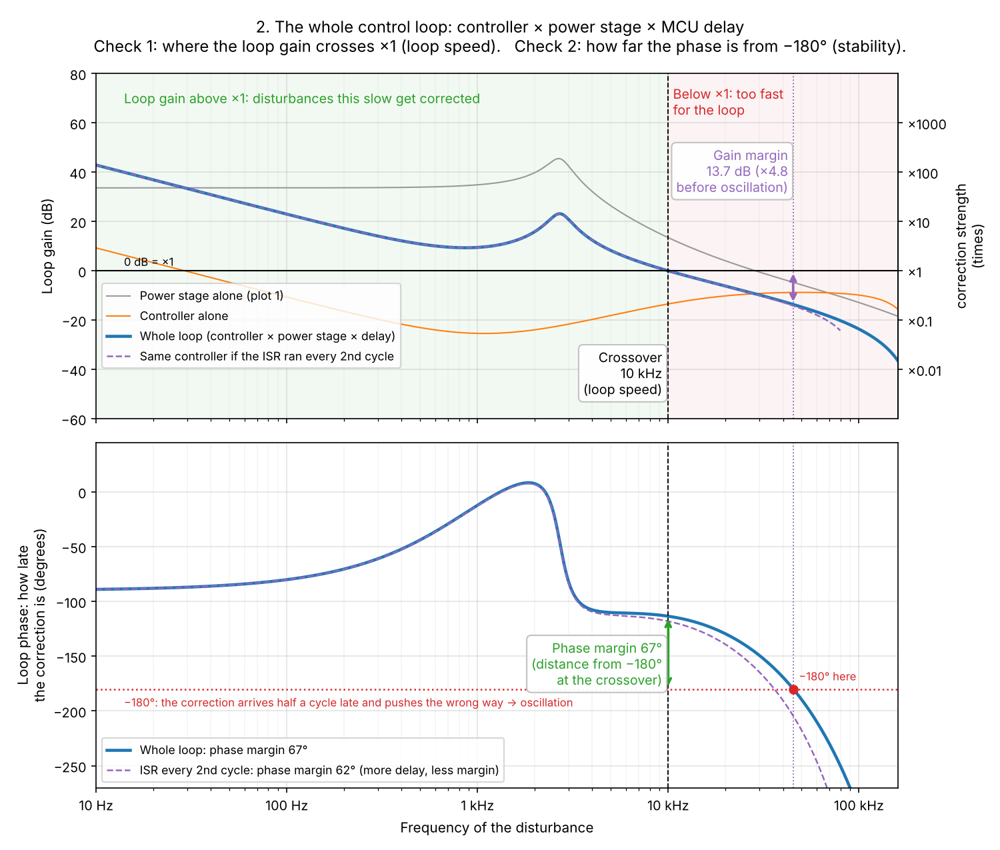
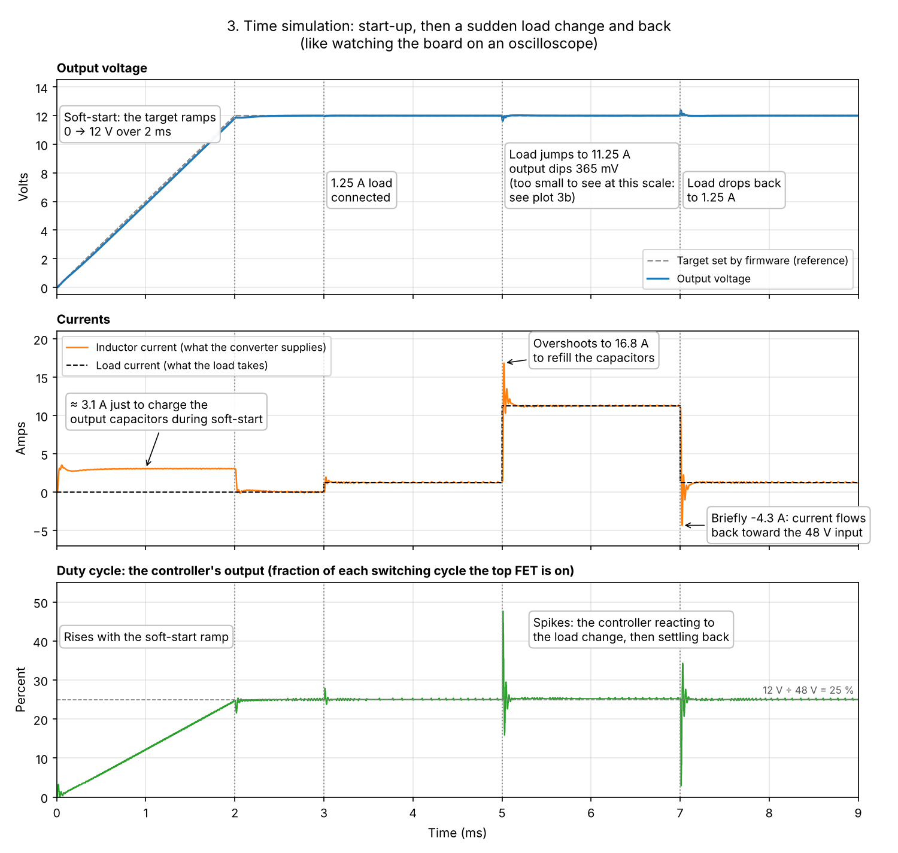
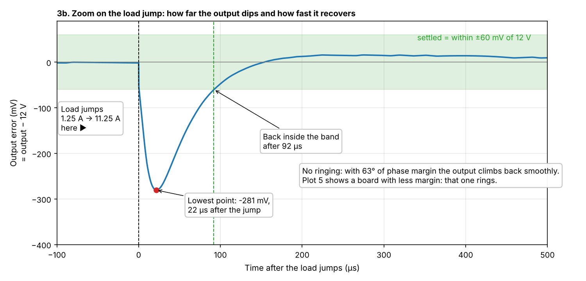
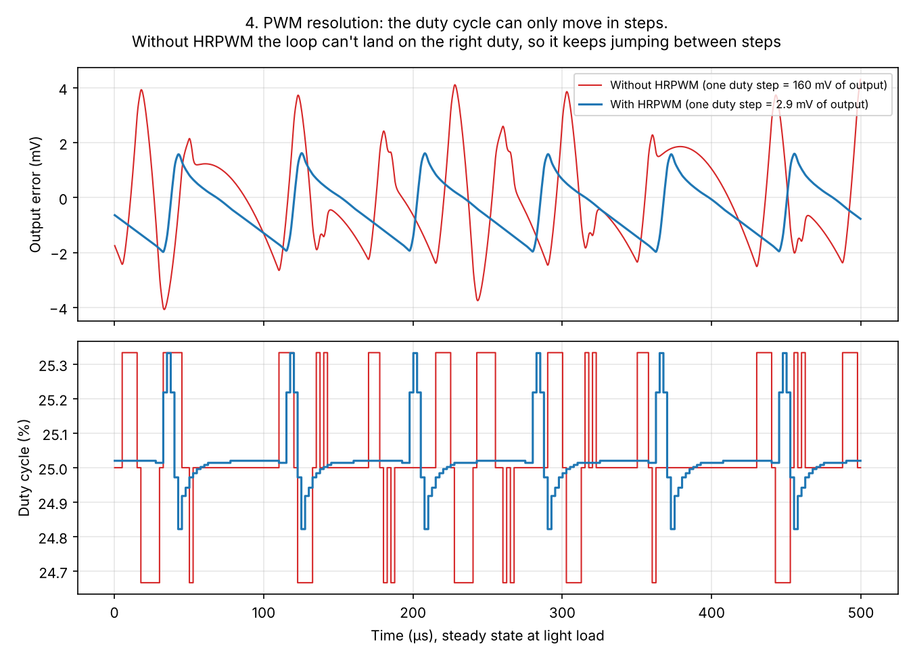
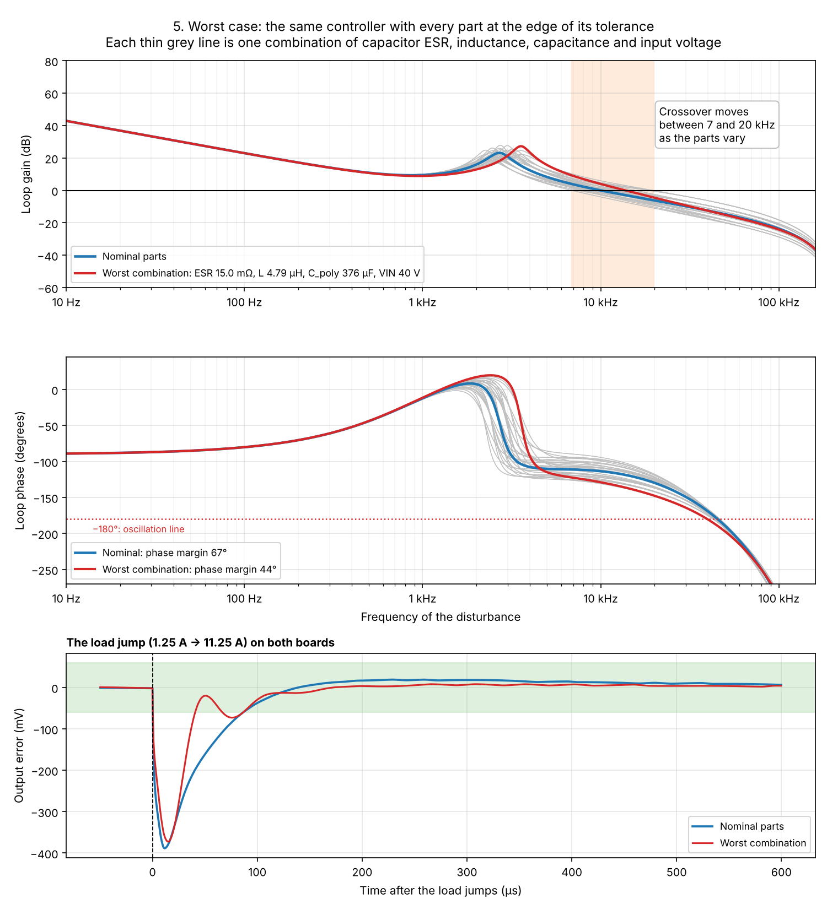
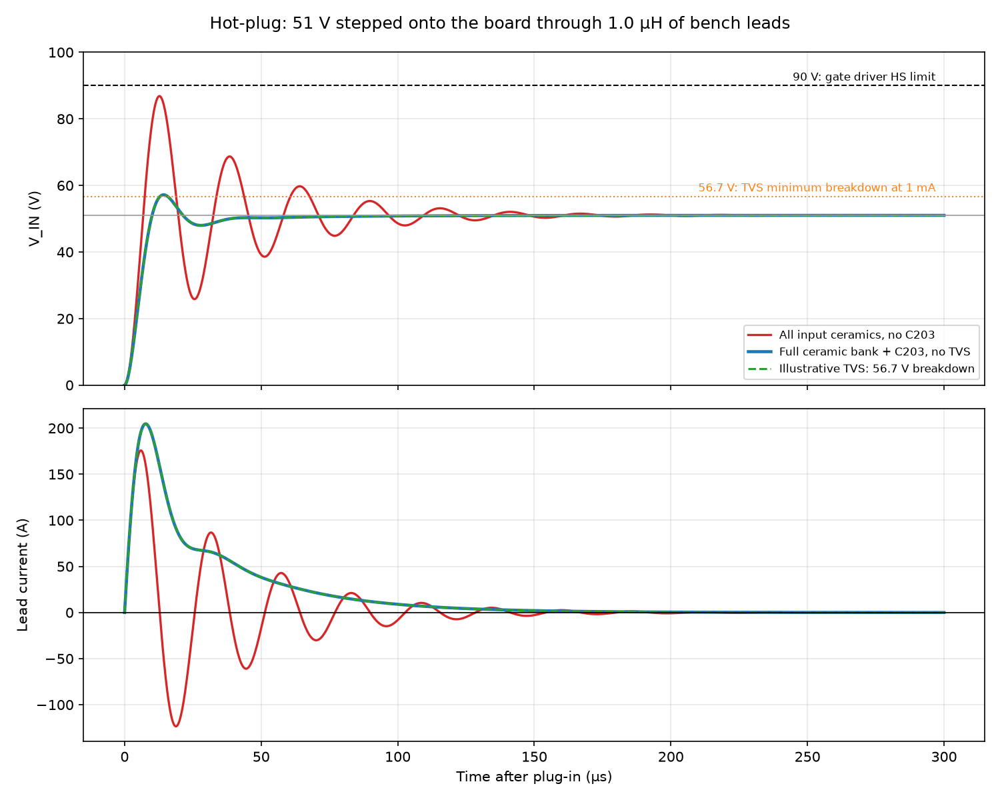
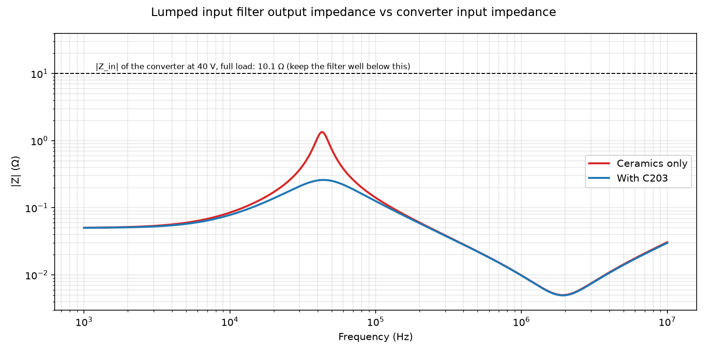
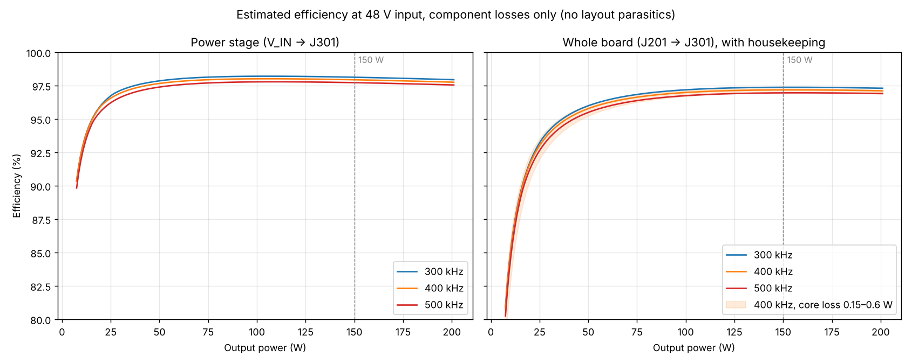
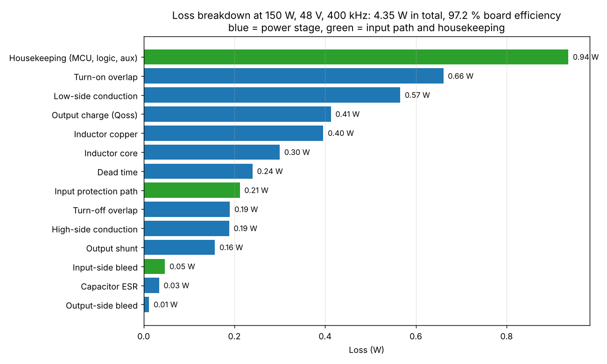

# Simulations

Computer models of the converter, used to design the control loop before the hardware exists and to check what the bench measures against what we expected.

| Script | What it models | Status |
|---|---|---|
| [voltage_mode_sim.py](voltage_mode_sim.py) | Voltage-mode control (firmware stage 2): plant, Type III controller, digital delay, soft-start, load step, worst-case part tolerances | Parameters from the inductor, polymer-capacitor and GaN FET datasheets |
| [input_hotplug_sim.py](input_hotplug_sim.py) | The 48 V input: hot-plug ringing, illustrative TVS pulse, C203 ripple current and input-filter stability | Lumped screening model; lead/trace parasitics and C203 ESR are ASSUMED |
| [efficiency_estimate.py](efficiency_estimate.py) | Component loss budget: theoretical efficiency vs load, input voltage and switching frequency | Datasheet losses only; layout parasitics excluded, inductor core loss and aux-buck efficiency ASSUMED |
| [ltspice/](ltspice/README.md) | Switching simulation of the power stage in LTspice: both GaN FETs (Infineon's model), gate drive, bootstrap and capacitor banks, open loop at full load | Results from an ngspice run of the same circuit. Layout parasitics are ASSUMED |
| [KiPI board setup](../hardware/gan-buck-converter/gan-buck-converter.kipi-setup.yml) | PCB power-integrity setup with a 48 V source at C203, a 12 V converter model and a 12.5 A load at U302 | Project setup for the power stage. The routed-board efficiency run applies its source at CN201 to include the input path. |

Planned next: average current mode (stage 3), and adding the controller and current limit to the LTspice simulation.

---

## Routed board KiPI and ngspice (2026-11-27)

KiPI 1.0.2 used the Q201-equipped PCB at commit `34a5a8d`, with 1,155 track segments, 497 vias and 32 zones. The current layout connects CN201 pin 1 directly to `GND`. Keep the archived efficiency setup with its source PCB and use the current return topology when modeling the new board. [Simulated PCB revision](https://github.com/HexaGaN-org/gan-buck-converter/tree/34a5a8d9eed4287f3b78bd3c5dbb7f172f4f74ce/hardware/gan-buck-converter) · [Current input circuit](../docs/design/input_supply.md)

The AC field solve used PARDISO at 43 frequencies through 1.224 GHz. The [nominal noise setup](output/3v3-reconnected-kipi/nominal-noise.kipi-setup.yml) drives the buck input at C203, and the [board efficiency setup](output/3v3-reconnected-kipi/48V-12.5A-400kHz.kipi-setup.yml) drives the XT30 input at CN201. The [KiPI summary](output/3v3-reconnected-kipi/kipi-summary.json) records the hash of the KiCad-saved file before Git normalizes its line endings.

### PCB connectivity

KiCad 10 reported one missing connection, zero clearance violations under the saved project rules, zero schematic parity issues and 398 silkscreen warnings after zone refill. The open is between front `stitch_zone_0` at (106.40, 83.80) mm and back `3v3` at (105.90, 79.25) mm. KiPI found 7 of 60 `+3V3` pads unreachable from U202 pins 2 and 4. The affected pads are C403.2, C408.2, C409.2, R410.2, U402.5, U404.5 and U405.7. The efficiency model includes the intended auxiliary rail loads. [Pad connectivity](output/3v3-reconnected-kipi/3v3-connectivity.json)

### Commutation loop and waveforms

At 48 V, 12.5 A and 400 kHz, KiPI estimates **0.535 nH** effective commutation-loop inductance including capacitor ESL, **7.11 mΩ** effective loop resistance, and **296 MHz** ringing. A finer mesh gives 0.536 nH and approximately the same frequency. KiPI uses 540 pF of device output capacitance, a lumped damping floor and zero added package inductance for this calculation. Varying inductance or device capacitance gave 243–342 MHz. [Hot-loop paths and branch currents](output/3v3-reconnected-kipi/kipi-hot-loops.png) · [Finer mesh](output/3v3-reconnected-kipi/refined-hot-loop.json) · [Sensitivity sweep](output/3v3-reconnected-kipi/model-sensitivity.json)

| Nominal waveform | Predicted value |
|---|---:|
| KiPI switch-node range | −1.50 to 59.31 V |
| L301 current ripple | 3.33 A p-p |
| C304 input ripple at 20 MHz bandwidth | 0.86 V p-p |
| U302 output ripple at 20 MHz bandwidth | 30.0 mV p-p |
| U302 output ripple across the modeled bandwidth | 59.1 mV p-p |

The nine KiPI ripple cases peak at 35.6 mV p-p at U302 with a 20 MHz filter, at 51 V, 12.5 A and 300 kHz. The quasi-static field model adds uncertainty at the upper end of the frequency range. KiPI reports truncated paths in some capacitor overlays. It uses straight-line paths in the output overlay where R301 divides the nets, while the DC and AC solves include the shunt. [Waveforms](output/3v3-reconnected-kipi/kipi-waveforms.png) · [Ripple sweep](output/3v3-reconnected-kipi/ripple-sweep.json)

### Gate and driver stress

The ngspice edge replay uses Infineon's IGC033S10S1 model, a behavioral LM5113-Q1, lumped gate and return parasitics, and the nominal L301 current ramp. R303 and C310 are DNP. The nominal switch node rings at 298 MHz and spans −4.25 to 52.23 V. The nominal R305 value is 2 Ω. Q302's off-state gate reaches **1.29 V**, compared with Infineon's 1.2 V minimum threshold at its specified test current. Shared-source inductance scenarios give 0.66–1.75 V. The 4.7 Ω R305 case slows high-side turn-on and gives 1.10 V. [Edge waveforms](output/3v3-reconnected-kipi/ngspice-edges.png) · [Infineon datasheet](https://www.infineon.com/assets/row/public/documents/24/49/infineon-igc033s10s1-datasheet-en.pdf)

U301 HS-to-VSS reaches −3.41 V in the nominal replay. The 18 ns commanded dead-time case goes below TI's −5 V rating. The 60 ps timestep case reaches approximately −10 V for a subnanosecond excursion, with about 0.10 ns continuously below −5 V. The peak varies with timestep and the behavioral driver lacks negative-HS protection behavior. The efficiency model uses 18 ns of effective dead time. [Driver voltage plot](output/3v3-reconnected-kipi/driver-HS-dead-time.png) · [Edge sweep](output/3v3-reconnected-kipi/ngspice-edge-sweep.json) · [TI datasheet](https://www.ti.com/lit/ds/symlink/lm5113-q1.pdf)

### Board efficiency

From CN201 to U302 solder pads, the 48 V, 12.5 A, 400 kHz case draws 154.68 W and delivers 149.62 W. Loss is **5.06 W**, for **96.73% efficiency**. With 1 mΩ assumed per mating contact, efficiency is 96.51%. Extracted copper and dielectric losses total approximately 0.46 W, including the switch-node copper. The power balance includes device and magnetic losses, series components and the intended housekeeping loads. [Loss breakdown and efficiency curves](output/3v3-reconnected-kipi/board-efficiency.png) · [Numerical loss audit](output/3v3-reconnected-kipi/board-efficiency.json)

| Input (V) | Load (A) | PWM (kHz) | Total loss (W) | Efficiency |
|---:|---:|---:|---:|---:|
| 48 | 12.50 | 400 | 5.06 | 96.73% |
| 48 | 6.25 | 400 | 2.85 | 96.34% |
| 48 | 2.50 | 400 | 2.01 | 93.72% |
| 40 | 12.50 | 400 | 4.92 | 96.82% |
| 51 | 12.50 | 400 | 5.12 | 96.69% |
| 48 | 12.50 | 300 | 4.74 | 96.93% |
| 48 | 12.50 | 500 | 5.44 | 96.49% |

Full-load loss scenarios span 96.26–96.91% across the modeled copper and FET temperatures, inductor core loss, auxiliary efficiency and dead time. The nominal case uses 4.8 mΩ hot GaN on-resistance, 0.30 W assumed core loss and 80% auxiliary conversion efficiency. Harness loss, inductor AC winding loss and thermal feedback remain unquantified. [Loss sensitivity](output/3v3-reconnected-kipi/model-sensitivity.json)

---

## Quick start

```
cd simulations
pip install -r requirements.txt
python voltage_mode_sim.py          # prints a summary, saves plots to output/
python voltage_mode_sim.py --show   # also opens the plot windows
python voltage_mode_sim.py --help   # options
python input_hotplug_sim.py         # the input hot-plug check, plots saved to output/input_*.png
python efficiency_estimate.py       # the efficiency estimate, plots saved to output/eff_*.png
```

It runs in under ten seconds. All parameters are at the top of the script, each with its source. Values marked **ASSUMED** are not decided yet; update them as the design firms up.

---

## What the script models

```
            error               duty                      VOUT
 reference ──►(−)──► controller ──► × VIN_nominal / VIN ──► power stage ──┬──► output
 (12 V)        ▲     (Type III,     (input-voltage          (FETs,         │
               │      in the ISR)    feedforward)            inductor,     │
               │                                             capacitors)   │
               └──── ADC reading (12-bit) ◄── divider ◄────────────────────┘
                     taken once per PWM cycle; the new duty
                     takes effect one cycle later
```

- **Averaged model.** The switch node is replaced by its average over each PWM cycle (duty × 48 V). This keeps everything the control loop sees and removes the switching ripple, which makes the simulation fast. Real ripple (≈ 19 mV p-p) comes on top of these results.
- **Digital controller, run the way firmware will run it.** Sampled once per cycle, rounded to 12 ADC bits, a one-cycle delay before the new duty applies, duty clamped, and duty rounded to the PWM's resolution (with or without HRPWM).
- **Input-voltage feedforward.** The duty is scaled by 48 V ÷ the measured input voltage. Without it, the loop gain rises and falls with the input voltage. `V_IN_SENSE` is already planned for this in `schematic-hierarchy.md`.
- **Load** is an electronic load in constant-current mode, the hardest case for stability because it adds no damping.
- **Worst case.** The same controller is re-checked with every combination of part tolerances (plot 5).

---

## Reading the plots

### 1. The plant: the power stage on its own



A **Bode plot** shows how strongly the output responds (top) and how late it responds (bottom) when the duty cycle wiggles at each frequency.

- The peak at **2.6 kHz** is the **LC resonance**: the inductor and output capacitors behave like a mass on a spring. Above it the gain falls quickly and the phase drops by about 180°. This is what makes a buck hard to control.
- The polymer capacitors' ESR (their internal resistance) gives some phase back, but only around **59 kHz**: the two 10 mΩ parts in parallel are 5 mΩ. That is well above the crossover, so the controller has to supply the phase itself (see *What we've learned*, point 1).

### 2. The full loop



The controller (orange) is shaped so that the **loop gain** (blue = controller × plant × delay) does two things:

- It is large at low frequencies, so the output sits exactly at 12 V.
- It **crosses 0 dB at 10 kHz**. This crossover frequency is how fast the loop reacts.

The bottom panel shows **phase margin**: at crossover, how far the phase is from −180°, the point where the loop would oscillate. With nominal parts the design has **63°**. **Gain margin** (how much the gain could rise before oscillation) is **15.2 dB**. Both are deliberately generous: plot 5 shows why.

The dashed purple line shows what happens if the control ISR ran every second PWM cycle instead of every cycle. The extra delay costs phase, and the phase margin drops to 59°.

### 3. Soft-start and a load step



- **0–2 ms:** the firmware ramps the reference from 0 to 12 V (soft-start), and the output follows it closely. The inductor carries about 3 A even with no load, just to charge the 550 µF of output capacitance.
- **3 ms:** a light load (1.25 A) is connected.
- **5 ms:** the load jumps to 11.25 A (10 % → 90 % of full load). The output dips, the controller raises the duty cycle, and the inductor current climbs to catch up.
- **7 ms:** the load drops back, and the output briefly overshoots.



The zoom shows the dip in detail: **about 280 mV**, back inside ±60 mV within **about 92 µs**, with no ringing.

### 4. PWM resolution



The duty cycle can only move in steps. Without HRPWM, one step is 1/300 of a period, which moves the output by 160 mV. The loop can't land on exactly the right duty, so it keeps jumping between neighboring steps (red). HRPWM makes the steps about 50 times finer (blue). The output filter smooths most of the jumping, but the wobble is still about 6 mV p-p without HRPWM against 3 mV with it. The remaining wobble with HRPWM comes from the 12-bit ADC's resolution.

### 5. Worst case



The controller is fixed in firmware, but every board's parts are slightly different and drift with temperature and age. Each thin grey line is the same controller with one combination of:

| Part | Range checked | Source |
|---|---|---|
| Polymer ESR (C316 ‖ C317) | 2.5 / 5 / 6.25 mΩ, plus 7.5 mΩ at end of life | NCC PXJ catalog: 10 mΩ max each at 20 °C, so 5 mΩ for the pair; up to 1.25× cold and 1.5× at end of life. 2.5 mΩ is ASSUMED (no minimum is published) |
| Inductance | 4.8 / 6.8 / 8.2 µH | ±20 % tolerance, plus about 12 % sag at full load (ASSUMED: no L-vs-current curve is published) |
| Polymer capacitance | 432 / 540 / 648 µF | ±20 % tolerance |
| Input voltage | 40 / 51 V | `specifications.md` (input_supply.md decision #2) |

The crossover moves between **7 and 17 kHz** across these combinations. The worst one (red) still has **47° phase margin** and **9.3 dB gain margin** with new parts: the lowest ESR, lowest inductance and lowest capacitance at 40 V. At end of life (7.5 mΩ ESR) the margins are 59° and 9.9 dB. The bottom panel shows the load step on the worst-case board: a 292 mV dip that settles in about 78 µs.

---

## The input: hot-plug and damping (`input_hotplug_sim.py`)

Plugging the board into a live supply connects the bench leads' inductance to the power stage **and U201** input ceramics. Their combined 51 V capacitance is estimated at 11.51 µF: 7.62 µF for the power-stage bank (three 10 µF and four 100 nF parts), interpolated from the recorded 48 V and 60 V values, plus 3.89 µF for U201's five 2.2 µF parts. These bias-curve readbacks are typical estimates, not guaranteed minima; Samsung's [current exact-part library](https://weblib.samsungsem.com/mlcc/mlcc-ec-data-sheet.do?partNumber=CL32Y106KCV6PN) provides no bias or ripple-current graphs for the 10 µF part. C203 is the selected Ymin VKME1452A101MV 100 µF bulk capacitor. Its exact-part ESR is unpublished; the script uses 0.32 Ω as an **assumed** scenario and sweeps half and twice that value to expose sensitivity.



| Assumed bench-lead inductance | Ceramics only, no TVS | With C203, no TVS | Modeled lead I²t with C203 |
|---|---|---|---|
| 0.5 µH | 84.6 V | 56.6 V | 0.53 A²s |
| 1 µH | 89.0 V | 55.1 V | 0.50 A²s |
| 2 µH | 92.4 V | 54.6 V | 0.49 A²s |

All three nominal no-TVS results sit below the fitted SMBJ51CA's **56.7 V minimum breakdown at 1 mA**, the 0.5 µH case by only 0.1 V, so the illustrative same-node TVS branch, anchored to the [Hongjiacheng datasheet endpoints](https://xonstorage.z8.web.core.windows.net/pdf/hongjiacheng_smbj170a__xonlink.pdf), does not conduct with nominal values. Sweeping ceramic capacitance (8.34–15.14 µF using separate X7S and X7R illustrative tolerance/temperature factors), C203 (80–120 µF), an **assumed** ESR range (0.16–0.64 Ω), and leads (0.5–2 µH) gives up to 67.1 V without the TVS, or about 2.86 A peak and 1.21 mJ in the low-breakdown TVS model. These are sensitivity results, **not** manufacturer-guaranteed I–V, pulse-energy or thermal ratings. The manufacturer's 600 W rating applies to a 10/1000 µs pulse with temperature derating.

This hot-plug model uses a lumped node and assumes 50 mΩ around the leads and the earlier input path with Q201. It drives the leads with an ideal 51 V step and predicts nominal inrush of up to 229 A. Real lead inductance, supply current limit and the current fused-node and C203 voltages need measurement before routine live connection. [Input verification](../docs/design/input_supply.md#verification)



The same leads and capacitors form an input filter in front of a converter whose input impedance is *negative* (draw more current as the voltage falls). Its modeled output-impedance peak is 1.60 Ω without C203 and 0.27 Ω with C203, versus about 10 Ω converter input impedance at 40 V and full load. Layout parasitics can change this estimate.

**C203 now uses a higher-ripple part, but its damping is open.** The harmonic model gives about 0.44 A rms at 48 V/400 kHz and 0.68 A rms at 40 V/300 kHz, using the 51 V ceramic estimate at every input voltage. [Ymin rates VKME1452A101MV at 1.04 A rms at 100 kHz/105 °C](https://www.ymin.cn/chip-miniature-type-aluminum-electrolytic-capacitors-vkm-product/), about 1.53× the modeled worst operating current. C203 carries more of the ripple now that the ceramic bank beside it is smaller. Ymin does not publish an exact-part ESR or impedance here, so the assumed 0.32 Ω damping and resulting hot-plug/TVS estimates must be checked against measured samples and the built board. Confirm JLC assembly availability and footprint fit before release.

Verification test 3 in `input_supply.md` measures the actual hot-plug with PWM disabled. A surge while switching also needs the fast input-trip response and switch-node overshoot checked against the driver's HS limit.

---

## Efficiency (`efficiency_estimate.py`)

This layout-independent loss budget uses datasheet values and assumptions for inductor core loss and the auxiliary regulator. The input model includes the earlier Q201 path. The GaN conduction estimate uses the hot maximum $R_{DS(on)}$ of 4.8 mΩ. [Routed-board efficiency](#board-efficiency)



| Whole board (J201 → J301), 48 V | 15 W | 30 W | 75 W | 112 W | 150 W | 200 W |
|---|---|---|---|---|---|---|
| 300 kHz | 89.4 % | 94.2 % | 96.8 % | 97.3 % | 97.4 % | 97.3 % |
| 400 kHz | 89.2 % | 93.9 % | 96.6 % | 97.1 % | **97.2 %** | 97.1 % |
| 500 kHz | 88.9 % | 93.6 % | 96.4 % | 96.8 % | 97.0 % | 96.9 % |

The power stage alone (`V_IN` to J301) reaches 97.9 % at 150 W and peaks at about 98.0 % near 120 W. Input voltage barely matters: 97.3 % at 40 V, 97.1 % at 51 V (whole board, 150 W).



At 150 W the board loses about 4.35 W:

- **Housekeeping, 0.94 W.** The aux buck feeds about 150 mA at 5 V to the MCU, logic, sensing, LEDs and gate driver. It is fixed, so it is what pulls light-load efficiency down: at 30 W it is about half of the 1.9 W total.
- **Power stage, 3.2 W.** The largest parts are the high-side turn-on overlap (0.66 W), low-side conduction (0.57 W) and the $Q_{oss}$ loss (0.41 W). Switching losses scale with frequency, which is why 300 kHz wins at full load.
- **Inductor, 0.70 W**, of which 0.30 W is core loss. L301 has an iron-powder core and no published core-loss data, so that figure is ASSUMED; sweeping it from 0.15 to 0.6 W moves full-load efficiency between 97.3 % and 97.0 %.
- **Input path, 0.21 W:** the fuse (9 mΩ), R201 and the hot Q201.

Two inputs are assumptions worth replacing first: the inductor core loss (measure it, or ask Sunltech) and the aux-buck efficiency (80 % assumed; TI's curve for 48 V to 12 V reads about 88 % at this load, and a 5 V output will be lower). Verification test 7 in `power_stage.md` measures the real curve.

---

## What we've learned so far

1. **The low-ESR output bank moves the controller's first pole.** The two polymers in parallel are 5 mΩ, which puts their ESR zero near 59 kHz, far above the 10 kHz crossover, so the plant no longer gives phase back where the loop needs it. With the first pole at the automatic 16 kHz the loop has only 41° of phase margin with nominal parts and 21° at the worst corner. Moving that pole onto the ESR zero (`FP1 = 59e3`) restores 63° nominal and 47° worst case.
2. **The controller has to be designed for the worst-case board, not the nominal one.** A low inductance and a low polymer capacitance together raise the crossover by about 70 %, and the extra speed runs into the digital delay. A design tuned to 20 kHz with nominal parts looks fine (51° phase margin), but at the worst corner it falls to about 18° and 2.7 dB of gain margin. Tuning to 10 kHz keeps every corner stable.
3. **The slower loop costs some load-step dip.** The dip grows from about 217 mV (20 kHz) to 281 mV (10 kHz). With 5 mΩ of ESR only about 50 mV of it is the resistive step; the rest is the capacitors discharging before the loop reacts, which the estimate $\Delta I / (2\pi f_c C)$ puts at about 295 mV for a 10 kHz crossover. The load-transient target in `specifications.md` is still [TBD].
4. **Input-voltage feedforward is worth having.** Without it, the 40–51 V input range alone moves the loop gain by −1.6 to +0.5 dB, and the worst-case margins fall to 45° and 8.7 dB. With feedforward the input voltage drops out of the loop entirely.
5. **The slower loop also helps the current limit.** On the 10 A step the average inductor current peaks at about 13.6 A (15.3 A instantaneous with ripple), against about 17.4 A with a 20 kHz loop. The overcurrent threshold still has to sit above this.
6. **Run the control ISR every cycle if possible.** Running it every second cycle costs about 4° of phase margin at 10 kHz.
7. **The polymer's real ESR is the least certain input.** The NCC PXJ catalog gives only a maximum for APXJ160ARA271MF80J (10 mΩ at 20 °C, 100–300 kHz), a 5.08 A rms ripple rating and a 1.5× end-of-life limit. The 2.5 mΩ lower bound for the pair is ASSUMED, and it sets the worst corner. Measure the fitted parts, or the loop with SFRA, before trusting the margins.

---

## Things to try

Change a value at the top of the script (or use an option), rerun, and compare.

| Try | How | What to look for |
|---|---|---|
| Faster loop | `--fc 20` | Nominal margins look fine; the WORST CASE section shows the problem |
| Slower ISR | `--every 2` | Less phase margin |
| No HRPWM | `--no-hrpwm` | The duty keeps jumping between steps (plot 4) |
| No feedforward | `USE_VIN_FEEDFORWARD = False` | Worse worst-case margins |
| Automatic first pole | `FP1 = None` (16 kHz) | Phase margin falls to 41° nominal and 21° at the worst corner |
| Move the controller zeros | `FZ1`, `FZ2` | Placing them lower adds phase margin but slows the low-frequency response |
| Resistive load | `LOAD_R = 0.96` (full load) | More damping at the resonance, so the peak in plot 1 shrinks |
| Longer soft-start | `SOFTSTART_TIME = 5e-3` | Lower capacitor-charging current at start-up |

---

## Parameters and their sources

| Item | Value used | Source |
|---|---|---|
| Inductance | 6.8 µH ±20 % | Sunltech SLB2212P6R8MTT datasheet |
| Inductor DCR | 2.1 mΩ typ (2.31 mΩ max) | Same |
| Inductance at full load | −12 % | ASSUMED: straight line to the 30 % drop at I<sub>sat</sub> = 31 A |
| GaN R<sub>DS(on)</sub>, hot | 4.8 mΩ | IGC033S10S1: 3.3 mΩ max × 1.45 at about 80 °C (Diagram 11) |
| Polymer capacitance | 540 µF ±20 % (2 × 270 µF) | [NCC PXJ catalog](https://chemi-con.com/wp-content/uploads/2021/05/NPCAP-PXJ-Series.pdf), APXJ160ARA271MF80J |
| Polymer ESR | 5 mΩ for the pair, 2.5–7.5 mΩ range | Same: 10 mΩ max each; see plot 5 |
| Ceramic capacitance | 9.7 µF effective | `power_stage.md` decision #24 (DC-bias derated) |
| Ceramic ESR | 2 mΩ for the bank | ASSUMED; barely affects the results |
| PCB resistance | 1 mΩ | ASSUMED; estimate after layout |
| VOUT divider | 0.2 (16.5 V full scale) | ASSUMED; replace with the sensing sheet's divider |
| Sense-line RC filter | Not modeled | Add once the sensing sheet chooses it: it adds delay and costs phase |
| MCU delay | 1 PWM cycle + hold | ASSUMED; confirm from the firmware timing |
| Input voltage range | 40–51 V | `specifications.md` |

**Limits:**

- **Averaged model:** no switching ripple, and no behavior within a cycle. That needs a switching simulation (LTspice or PLECS).
- **Voltage mode only.** Average current mode, with its inner current loop, is the next script.
- **Coefficients:** the summary prints the digital coefficients as u[n] = b0·e[n] + … − a1·u[n−1] − …. The C2000 Digital Control Library may use a different sign convention, so check it before copying them into firmware.

A simulation is only as good as its parameters. Once the board runs, measure the real loop with TI's SFRA, compare it with plot 2, and update the model until the two agree.
