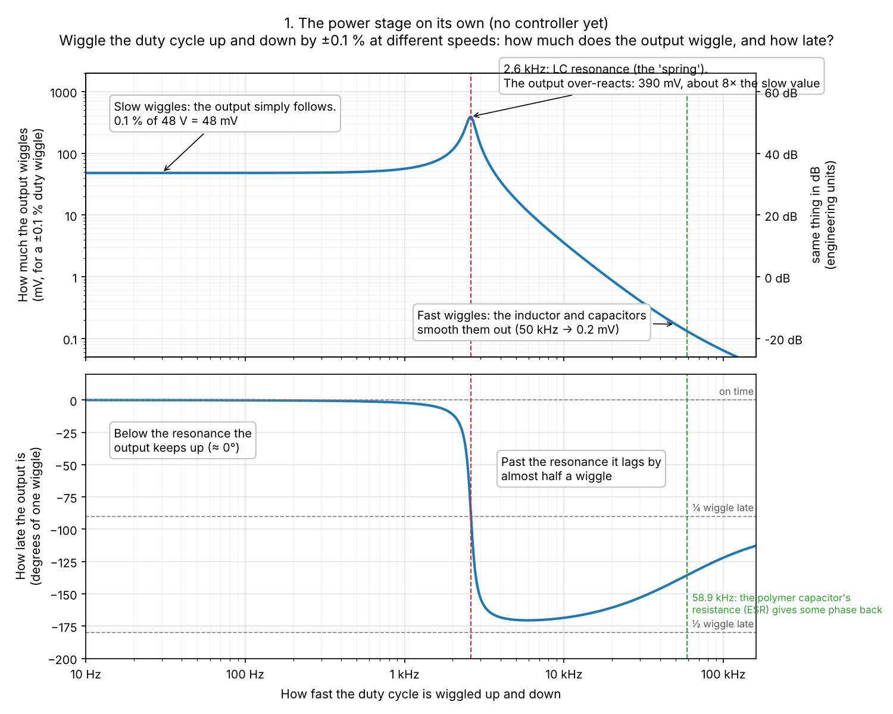
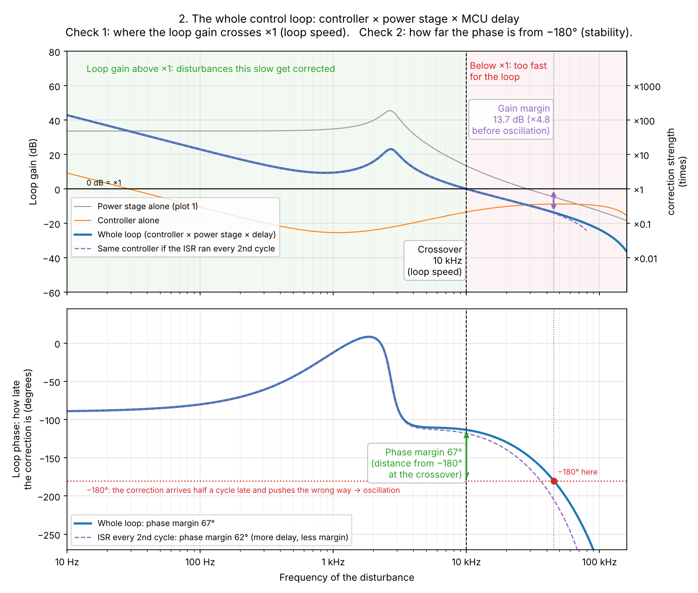
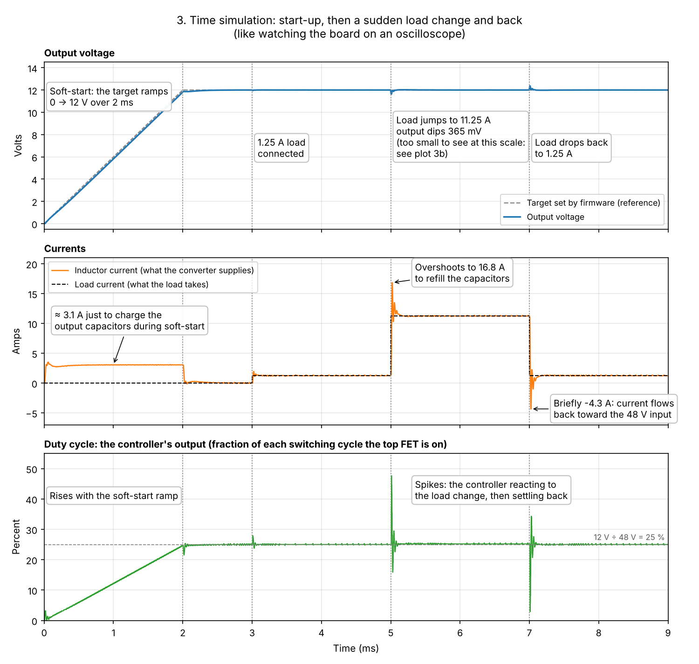
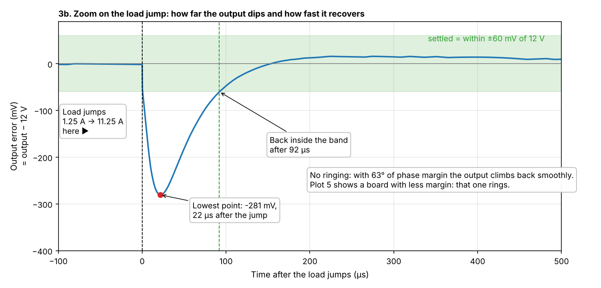
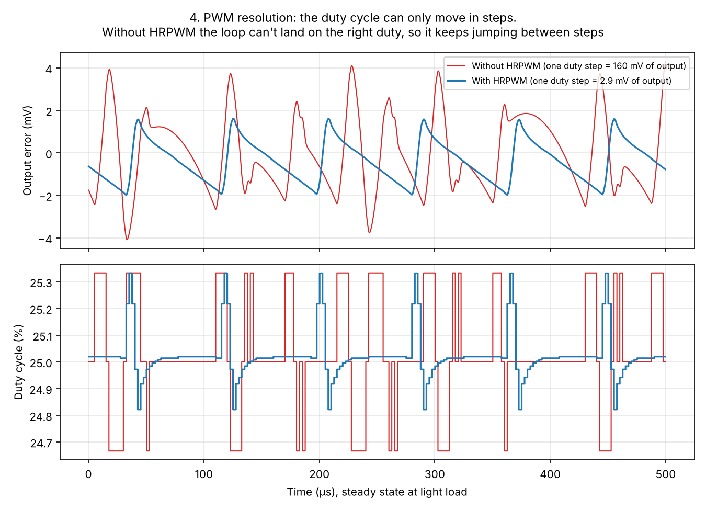
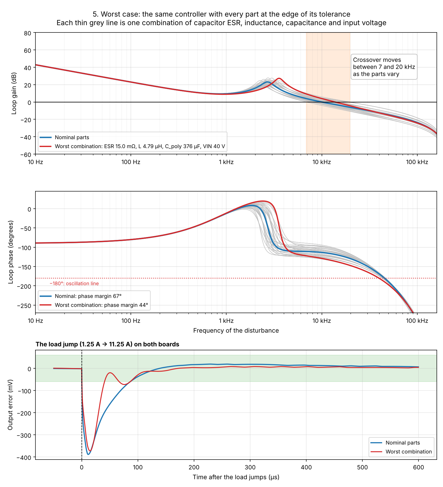
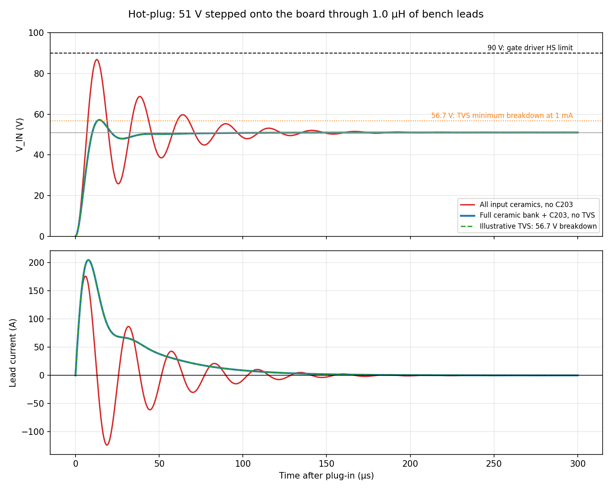
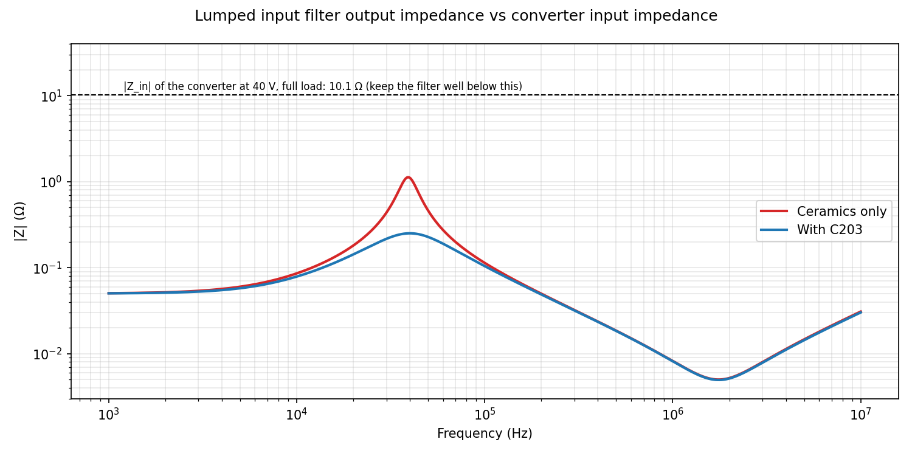

# Simulations

Computer models of the converter, used to design the control loop before the hardware exists and to check what the bench measures against what we expected.

| Script | What it models | Status |
|---|---|---|
| [voltage_mode_sim.py](voltage_mode_sim.py) | Voltage-mode control (firmware stage 2): plant, Type III controller, digital delay, soft-start, load step, worst-case part tolerances | Parameters from the inductor, polymer-capacitor and GaN FET datasheets |
| [input_hotplug_sim.py](input_hotplug_sim.py) | The 48 V input: hot-plug ringing, illustrative TVS pulse, C203 ripple current and input-filter stability | Lumped screening model; lead/trace parasitics and C203 ESR are ASSUMED |

Planned next: average current mode (stage 3), and an LTspice switching simulation to check ripple and the current limit.

---

## Quick start

```
cd simulations
pip install -r requirements.txt
python voltage_mode_sim.py          # prints a summary, saves plots to output/
python voltage_mode_sim.py --show   # also opens the plot windows
python voltage_mode_sim.py --help   # options
python input_hotplug_sim.py         # the input hot-plug check, plots saved to output/input_*.png
```

It runs in under ten seconds. All parameters are at the top of the script, each with its source. Values marked **ASSUMED** are not decided yet; update them as the design firms up.

---

## What the script models

```
            error               duty                      VOUT
 reference ──►(−)──► controller ──► × VIN_nominal / VIN ──► power stage ──┬──► output
 (12 V)        ▲     (Type III,     (input-voltage          (FETs,         │
               │      in the ISR)    feedforward)            inductor,     │
               │                                             capacitors)   │
               └──── ADC reading (12-bit) ◄── divider ◄────────────────────┘
                     taken once per PWM cycle; the new duty
                     takes effect one cycle later
```

- **Averaged model.** The switch node is replaced by its average over each PWM cycle (duty × 48 V). This keeps everything the control loop sees and removes the switching ripple, which makes the simulation fast. Real ripple (≈ 27 mV p-p) comes on top of these results.
- **Digital controller, run the way firmware will run it.** Sampled once per cycle, rounded to 12 ADC bits, a one-cycle delay before the new duty applies, duty clamped, and duty rounded to the PWM's resolution (with or without HRPWM).
- **Input-voltage feedforward.** The duty is scaled by 48 V ÷ the measured input voltage. Without it, the loop gain rises and falls with the input voltage. `V_IN_SENSE` is already planned for this in `schematic-hierarchy.md`.
- **Load** is an electronic load in constant-current mode, the hardest case for stability because it adds no damping.
- **Worst case.** The same controller is re-checked with every combination of part tolerances (plot 5).

---

## Reading the plots

### 1. The plant: the power stage on its own



A **Bode plot** shows how strongly the output responds (top) and how late it responds (bottom) when the duty cycle wiggles at each frequency.

- The peak at **2.7 kHz** is the **LC resonance**: the inductor and output capacitors behave like a mass on a spring. Above it the gain falls quickly and the phase drops by about 180°. This is what makes a buck hard to control.
- Around **13.5 kHz** the polymer capacitor's ESR (its internal resistance) gives some phase back.

### 2. The full loop



The controller (orange) is shaped so that the **loop gain** (blue = controller × plant × delay) does two things:

- It is large at low frequencies, so the output sits exactly at 12 V.
- It **crosses 0 dB at 10 kHz**. This crossover frequency is how fast the loop reacts.

The bottom panel shows **phase margin**: at crossover, how far the phase is from −180°, the point where the loop would oscillate. With nominal parts the design has **67°**. **Gain margin** (how much the gain could rise before oscillation) is **13.7 dB**. Both are deliberately generous: plot 5 shows why.

The dashed purple line shows what happens if the control ISR ran every second PWM cycle instead of every cycle. The extra delay costs phase, and the phase margin drops to 62°.

### 3. Soft-start and a load step



- **0–2 ms:** the firmware ramps the reference from 0 to 12 V (soft-start), and the output follows it closely. The inductor carries about 3 A even with no load, just to charge the 509 µF of output capacitance.
- **3 ms:** a light load (1.25 A) is connected.
- **5 ms:** the load jumps to 11.25 A (10 % → 90 % of full load). The output dips, the controller raises the duty cycle, and the inductor current climbs to catch up.
- **7 ms:** the load drops back, and the output briefly overshoots.



The zoom shows the dip in detail: **about 390 mV**, back inside ±60 mV within **about 86 µs**, with no ringing.

### 4. PWM resolution



The duty cycle can only move in steps. Without HRPWM, one step is 1/300 of a period, which moves the output by 160 mV. The loop can't land on exactly the right duty, so it keeps jumping between neighboring steps (red). HRPWM makes the steps about 50 times finer (blue). The output filter smooths most of the jumping, but the wobble is still about 23 mV p-p without HRPWM against 3 mV with it. The remaining wobble with HRPWM comes from the 12-bit ADC's resolution.

### 5. Worst case



The controller is fixed in firmware, but every board's parts are slightly different and drift with temperature and age. Each thin grey line is the same controller with one combination of:

| Part | Range checked | Source |
|---|---|---|
| Polymer ESR | 15 / 25 / 37.5 mΩ, plus 45 mΩ at end of life | Datasheet max 30 mΩ at 20 °C; up to 1.25× hot and 1.5× at end of life. 15 mΩ is ASSUMED (no minimum is published) |
| Inductance | 4.8 / 6.8 / 8.2 µH | ±20 % tolerance, plus about 12 % sag at full load (ASSUMED: no L-vs-current curve is published) |
| Polymer capacitance | 376 / 470 / 564 µF | ±20 % tolerance |
| Input voltage | 40 / 51 V | `specifications.md` (input_supply.md decision #2) |

The crossover moves between **7 and 20 kHz** across these combinations. The worst one (red) still has **44° phase margin** and **7.3 dB gain margin** with new parts. At end of life (45 mΩ ESR) the gain margin falls to **5.9 dB**, just under the 6 dB target. The bottom panel shows the load step on the worst-case board: it rings a little, but it is stable.

---

## The input: hot-plug and damping (`input_hotplug_sim.py`)

Plugging the board into a live supply connects the bench leads' inductance to the power stage **and U201** input ceramics. Their combined 51 V capacitance is estimated at 16.49 µF: 12.60 µF for the revised five-part power-stage bank, interpolated from the recorded 48 V and 60 V values, plus 3.89 µF for U201's five 2.2 µF parts. These bias-curve readbacks are typical estimates, not guaranteed minima; Samsung's [current exact-part library](https://weblib.samsungsem.com/mlcc/mlcc-ec-data-sheet.do?partNumber=CL32Y106KCV6PN) provides no bias or ripple-current graphs for the 10 µF part. C203 is the selected Ymin VKME1452A101MV 100 µF bulk capacitor. Its exact-part ESR is unpublished; the script uses 0.32 Ω as an **assumed** scenario and sweeps half and twice that value to expose sensitivity.



| Assumed bench-lead inductance | Ceramics only, no TVS | With C203, no TVS | Modeled lead I²t with C203 |
|---|---|---|---|
| 0.5 µH | 81.9 V | 57.8 V | 0.63 A²s |
| 1 µH | 86.8 V | 57.2 V | 0.59 A²s |
| 2 µH | 90.8 V | 56.8 V | 0.56 A²s |

All three nominal no-TVS results slightly exceed the fitted SMBJ51CA's **56.7 V minimum breakdown at 1 mA**. The illustrative same-node TVS branch, anchored to the [Hongjiacheng datasheet endpoints](https://xonstorage.z8.web.core.windows.net/pdf/hongjiacheng_smbj170a__xonlink.pdf), gives about 0.31 A peak and 0.030 mJ for the 0.5 µH case. Sweeping ceramic capacitance (11.83–21.82 µF using separate X7S and X7R illustrative tolerance/temperature factors), C203 (80–120 µF), an **assumed** ESR range (0.16–0.64 Ω), and leads (0.5–2 µH) gives up to 67.8 V without the TVS, or about 3.04 A peak and 1.91 mJ in the low-breakdown TVS model. These are sensitivity results, **not** manufacturer-guaranteed I–V, pulse-energy or thermal ratings. The manufacturer's 600 W rating applies to a 10/1000 µs pulse with temperature derating.

D201 is upstream of the low-side Q201; C203 and the ceramics are downstream. The model collapses them into one node, omits Q201's initial body-diode behavior and layout parasitics, and drives the leads with an ideal 51 V step. Its nominal inrush reaches about 259 A; a real bench supply and cables will differ. Neither the modeled TVS pulse nor the fuse's 10.3 A²s melting I²t qualifies the hardware. Do not assume live hot-plug is safe until the first board is measured with the intended supply and leads.



The same leads and capacitors form an input filter in front of a converter whose input impedance is *negative* (draw more current as the voltage falls). Its modeled output-impedance peak is 1.12 Ω without C203 and 0.25 Ω with C203, versus about 10 Ω converter input impedance at 40 V and full load. Layout parasitics can change this estimate.

**C203 now uses a higher-ripple part, but its damping is open.** The harmonic model gives about 0.31 A rms at 48 V/400 kHz and 0.47 A rms at 40 V/300 kHz, using the 51 V ceramic estimate at every input voltage. [Ymin rates VKME1452A101MV at 1.04 A rms at 100 kHz/105 °C](https://www.ymin.cn/chip-miniature-type-aluminum-electrolytic-capacitors-vkm-product/), about 2.21× the modeled worst operating current. Ymin does not publish an exact-part ESR or impedance here, so the assumed 0.32 Ω damping and resulting hot-plug/TVS estimates must be checked against measured samples and the built board. Confirm JLC assembly availability and footprint fit before release.

Verification test 3 in `input_supply.md` measures the actual hot-plug with PWM disabled. A surge while switching also needs the fast input-trip response and switch-node overshoot checked against the driver's HS limit.

---

## What we've learned so far

1. **The controller has to be designed for the worst-case board, not the nominal one.** A high-ESR polymer and a low inductance together roughly double the crossover frequency, and the extra speed runs into the digital delay. A design tuned to 20 kHz with nominal parts looks fine (70° phase margin), but at the worst corner its phase margin falls to about 3°: on the edge of oscillating. Tuning to 10 kHz keeps every corner stable.
2. **The slower loop costs almost nothing.** The load-step dip grows from about 362 mV (20 kHz) to 388 mV (10 kHz). The dip is set mostly by the output capacitors, not by the loop: right after a 10 A step the current comes from the capacitors before any controller can react, and the polymer's 25 mΩ ESR alone accounts for about 250 mV. The estimate in `power_stage.md` (≈ 125 mV) leaves out the ESR. The load-transient target in `specifications.md` is still [TBD].
3. **Input-voltage feedforward is worth having.** Without it, the 40–51 V input range alone moves the loop gain by −1.6 to +0.5 dB, and the worst-case margins fall to 43° and 6.8 dB. With feedforward the input voltage drops out of the loop entirely: narrowing the assumed 36–54 V range to the specified 40–51 V changed none of the margins.
4. **The slower loop also helps the current limit.** On the 10 A step the average inductor current now peaks at about 13.5 A (15.1 A instantaneous with ripple), down from about 15.6 A with a 20 kHz loop. The overcurrent threshold still has to sit above this.
5. **Run the control ISR every cycle if possible.** Running it every second cycle costs about 5° of phase margin at 10 kHz.
6. **The polymer datasheet doesn't match the BOM listing.** The datasheet supplied is Honorcap HV1E477M0810PZ: 30 mΩ max, 2.8 A ripple, 8 × 10.5 mm. The BOM part is jieerrui MA25V470M8x10, which LCSC lists at 25 mΩ and 4.1 A. Check which part will be fitted, and use that part's datasheet.

---

## Things to try

Change a value at the top of the script (or use an option), rerun, and compare.

| Try | How | What to look for |
|---|---|---|
| Faster loop | `--fc 20` | Nominal margins look fine; the WORST CASE section shows the problem |
| Slower ISR | `--every 2` | Less phase margin |
| No HRPWM | `--no-hrpwm` | The duty keeps jumping between steps (plot 4) |
| No feedforward | `USE_VIN_FEEDFORWARD = False` | Worse worst-case margins |
| Lower-ESR polymer | `ESR_POLY = 10e-3` (and the range) | Smaller dip, different worst corner |
| Move the controller zeros | `FZ1`, `FZ2` | Placing them lower adds phase margin but slows the low-frequency response |
| Resistive load | `LOAD_R = 0.96` (full load) | More damping at the resonance, so the peak in plot 1 shrinks |
| Longer soft-start | `SOFTSTART_TIME = 5e-3` | Lower capacitor-charging current at start-up |

---

## Parameters and their sources

| Item | Value used | Source |
|---|---|---|
| Inductance | 6.8 µH ±20 % | Sunltech SLB2212P6R8MTT datasheet |
| Inductor DCR | 2.1 mΩ typ (2.31 mΩ max) | Same |
| Inductance at full load | −12 % | ASSUMED: straight line to the 30 % drop at I<sub>sat</sub> = 31 A |
| GaN R<sub>DS(on)</sub>, hot | 4.8 mΩ | IGC033S10S1: 3.3 mΩ max × 1.45 at about 80 °C (Diagram 11) |
| Polymer capacitance | 470 µF ±20 % | Polymer datasheet |
| Polymer ESR | 25 mΩ nominal, 15–45 mΩ range | See plot 5 |
| Ceramic capacitance | 39 µF effective | `power_stage.md` decision #10 (DC-bias derated) |
| Ceramic ESR | 0.5 mΩ for the bank | ASSUMED; barely affects the results |
| PCB resistance | 1 mΩ | ASSUMED; estimate after layout |
| VOUT divider | 0.2 (16.5 V full scale) | ASSUMED; replace with the sensing sheet's divider |
| Sense-line RC filter | Not modeled | Add once the sensing sheet chooses it: it adds delay and costs phase |
| MCU delay | 1 PWM cycle + hold | ASSUMED; confirm from the firmware timing |
| Input voltage range | 40–51 V | `specifications.md` |

**Limits:**

- **Averaged model:** no switching ripple, and no behavior within a cycle. That needs a switching simulation (LTspice or PLECS).
- **Voltage mode only.** Average current mode, with its inner current loop, is the next script.
- **Coefficients:** the summary prints the digital coefficients as u[n] = b0·e[n] + … − a1·u[n−1] − …. The C2000 Digital Control Library may use a different sign convention, so check it before copying them into firmware.

A simulation is only as good as its parameters. Once the board runs, measure the real loop with TI's SFRA, compare it with plot 2, and update the model until the two agree.
